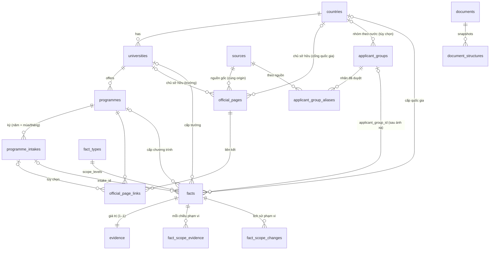

# L7b Architecture V3: tổng quát hóa cho nhiều trường

> **Chỉ là thiết kế.** Không sửa code, migration hay dữ liệu; không đăng ký nguồn; không crawl.
> Ngày: 2026-10-16. Cơ sở: `main` @ `e0c4e61`; `docs/architecture/l7b-pr2-architecture-review.md` (V2);
> `docs/architecture/cross-university-compatibility-review.md` (review nhiều trường); hợp đồng PR 2a/2b
> (`packages/db/src/rule-output.ts`); `schema.prisma` và các migration.
>
> Ký hiệu: **[Đã kiểm]** = thấy trong code/DB (chỉ đọc); **[Trang chính thức]** = đã đọc ngày 2026-10-16;
> **[Đề xuất]**; **[Đã duyệt hướng]** = X1, X2, X3, X8 (chỉ duyệt thiết kế); **[Cần xác nhận]**.
>
> V3 **thay thế** mục 4 (mô hình dữ liệu) và mục 6 (backlog L7b) của V2. Các quyết định D1–D12 của V2 vẫn giữ.
>
> **Cập nhật sau gate (2026-10-16, `l7b-v3-final-gate.md`):**
> - Điều kiện kế thừa theo bậc học (`condition_degree_types`, §2.5, §4, §5) **bị thay thế**: bậc học không đủ. Kế thừa
>   cần bản ghi áp dụng được duyệt **theo từng fact cho từng chương trình** (L7b-4).
> - SQL chính xác của 01–03 nằm ở `docs/architecture/l7b-v3-sql/`. SQL mẫu ở §5 dưới đây chỉ còn để tham khảo.

---

## 0. Những gì đã đổi so với V2

| V2 | V3 | Lý do |
|---|---|---|
| `programme_pages` (một chương trình mỗi dòng) | `official_pages` + `official_page_links` (nhiều liên kết) | X3: trang dùng chung (KU, UiO), cổng quốc gia |
| `facts.intake_applicability` ∈ {programme, intake} | Bộ **phạm vi** thống nhất: kỳ, nhóm người học, vòng tuyển, năm học; mỗi chiều ba trạng thái **chưa nói / tất cả / cụ thể** | X1; phân biệt "không rõ" với "áp dụng cho tất cả" |
| D13: nhóm người học chỉ cho học phí | Mọi loại fact có thể có nhóm người học; nhãn nguyên văn + **ánh xạ đã duyệt** | X1; UiO, TU Delft, KU chia **hạn nộp** theo nhóm |
| Fact tuyển sinh chỉ ở cấp chương trình | Cấp chương trình / trường / quốc gia + **kế thừa có điều kiện**, tính lúc đọc | X2 |
| Bằng chứng của phạm vi nằm trong câu trích | Bảng **`fact_scope_evidence`**: mỗi chiều phạm vi một bằng chứng | Nhóm hay kỳ thường nằm ở heading, không ở câu trích |

---

## 1. Hiện trạng liên quan [Đã kiểm]

| Mục | Giá trị (DB chỉ đọc 2026-10-16, migration) |
|---|---|
| `fact_types.applies_to` | CHECK ∈ {programme, university, immigration_rule, occupation, country}, **một** giá trị mỗi loại. Đang dùng: programme 12, immigration_rule 5, country 1, occupation 1 |
| Cấp của fact hiện có | 58 fact. Chương trình 21 (17 reviewed, 3 rejected, 1 proposed); trường 1 (reviewed); chỉ quốc gia 1 (reviewed); quy định nhập cư 16; nghề nghiệp 18; không gắn 1 |
| Ràng buộc | `facts_single_entity` (≤ 1 trong university / programme / immigration_rule / occupation); `facts_fact_type_country`; `evidence.fact_id` UNIQUE (1–1) |
| RLS | `universities_public/editors`, `programmes_public/editors`, `facts_public/editors`, `evidence_visible`, `fact_types_read` (toàn bộ là SELECT; ghi chỉ qua hàm SECURITY DEFINER) |
| Quyền | `education.manage` (đề xuất trường / chương trình), `facts.propose`, `facts.review` (duyệt), `sources.manage`, `crawler.manage` |
| Hợp đồng luật | `IntakeRef` (năm + mùa/tháng; heading hoặc page), `RuleCandidate.applicability ∈ {intake, programme, null}`, `suppressed?`, `eligibleForAutoProposal()` |

---

## 2. Mười quyết định kiến trúc

Mỗi quyết định: phương án, so sánh, **đề xuất**.

### 2.1 Phân loại nhóm người học (X1)

| Phương án | Ưu | Nhược |
|---|---|---|
| A. Danh sách đóng trên fact (`eu_eea_ch`, `non_eu_eea_ch`, …) | Đơn giản, so sánh được | Ép các nhóm khác nhau vào một mã: "Nordic citizens", "Dutch students", "Surinamese", "BSc from a non-Dutch university" **[Trang chính thức]** |
| B. Chỉ nhãn nguyên văn | Không mất thông tin | Không so sánh hay lọc được giữa các trường |
| **C. Nhãn nguyên văn trên fact + nhóm đã duyệt qua bảng ánh xạ** | Giữ nguyên văn; mỗi nhãn được ánh xạ **một lần**, có người duyệt; nhóm khác nhau không bị gộp | Thêm 2 bảng nhỏ |

**Đề xuất C:**
- `applicant_groups`: các nhóm **đã định nghĩa**, có thể theo quốc gia. Ví dụ "Công dân ngoài EU/EEA/Thụy Sĩ",
  "Cư trú tại Na Uy hoặc công dân Bắc Âu", "Có bằng cử nhân từ trường Hà Lan".
  - `basis` ∈ {citizenship, residence, prior_education, other};
  - mỗi nhóm có định nghĩa và trạng thái duyệt.
- `applicant_group_aliases`: (nguồn, nhãn nguyên văn đã chuẩn hóa) → nhóm. Chỉ có hiệu lực khi đã duyệt.
  **Không tự ánh xạ**: nhãn mới chưa có ánh xạ thì fact chỉ mang nhãn, `applicant_group_id = NULL`.
- So sánh và lọc (`/compare`) chỉ dùng `applicant_group_id`. Fact chưa ánh xạ hiện riêng, không gộp.

### 2.2 Vòng tuyển và kỳ nhập học

| Phương án | Ưu | Nhược |
|---|---|---|
| A. Vòng tuyển = biến thể của kỳ | Dùng bảng có sẵn | Một đợt nhập học bị tách thành nhiều kỳ (đúng loại trùng D1 cần tránh) |
| B. Thực thể `admission_rounds` (quốc gia/trường, có ngày) gắn với kỳ | Biểu diễn đầy đủ vòng tuyển quốc gia | Thực thể mới, ngày của vòng lại là fact; chỉ cần khi có X6 |
| **C. Nhãn vòng tuyển (nguyên văn) là một chiều phạm vi của fact** | Nhỏ; hai hạn cùng kỳ khác vòng không còn mâu thuẫn | Không có danh sách vòng chuẩn |

**Đề xuất C cho L7b.** Nếu sau này X6 được duyệt và cần thực thể vòng tuyển quốc gia, thì nâng lên B mà không phá dữ
liệu (nhãn vẫn giữ).

### 2.3 Năm học và định danh kỳ

| Phương án | Ưu | Nhược |
|---|---|---|
| A. Suy ra kỳ từ năm học ("2026-2027" → autumn 2026) | Gọn | **Suy diễn**, cấm |
| B. Dùng `valid_from / valid_until` | Có sẵn | Phải bịa ngày đầu / cuối năm học |
| **C. `academic_year` = nhãn chuẩn `YYYY-YYYY`, chỉ khi nguồn ghi; độc lập với kỳ** | Đúng điều nguồn nói | Thêm một cột |

**Đề xuất C.** Một fact có thể vừa có kỳ vừa có năm học, nhưng chỉ khi nguồn ghi **cả hai**. `academic_year` không bao
giờ tạo ra hay chọn kỳ.

### 2.4 Fact cấp chương trình, trường, quốc gia (X2)

| Phương án | Ưu | Nhược |
|---|---|---|
| A. Loại fact riêng cho mỗi cấp (`application_deadline_university`, …) | Không đổi ràng buộc | Nhân bản danh mục, khó so sánh |
| **B. `fact_types.scope_levels text[]`: các cấp cho phép; giữ `applies_to` làm cấp chính** | Tương thích ngược (mặc định = `ARRAY[applies_to]`); dùng cột thực thể sẵn có của `facts` | Sửa kiểm tra trong `propose_fact`, `set_fact_type`, `extractor_propose` |

**Đề xuất B.** Không có thực thể mới:
- cấp trường = `facts.university_id`;
- cấp quốc gia = chỉ `country_id`;
- cấp chương trình = `programme_id` (như hiện nay).

### 2.5 Kế thừa có điều kiện và thứ tự ưu tiên (X2)

**Đề xuất:**
- **Tính lúc đọc, không sao chép.** Hàm chỉ đọc `programme_effective_facts(programme_id)` (SECURITY INVOKER, chịu RLS)
  trả về fact của chương trình, cộng fact cấp trường / quốc gia **đủ điều kiện**, mỗi dòng có cột
  `inherited_from` (`programme` | `university` | `country`).
- **Điều kiện kế thừa phải do nguồn nêu và kiểm được tự động.** V3 chỉ có **bậc học**: `condition_degree_types text[]`,
  ví dụ trang KU "Master of Science programmes", trang UiO "master's degree programmes" **[Trang chính thức]**.
  Điều kiện không kiểm được (ví dụ "English-taught programmes") thì **không kế thừa tự động**; trang chương trình chỉ
  hiện link "quy định chung có thể áp dụng".
- **Thứ tự ưu tiên khi cùng loại fact và cùng phạm vi** (kỳ, nhóm, vòng, năm học): chương trình > trường > quốc gia.
  Cấp trên **cùng nghĩa** thì ẩn bớt. **Khác nghĩa** thì hiện cả hai, đánh dấu "khác với quy định chung", không ghi đè
  âm thầm (cùng tinh thần M1).
- Phạm vi "chưa nói" **không khớp** phạm vi cụ thể: một hạn của trường không nói nhóm người học sẽ không được coi là
  hạn của nhóm ngoài EU.

### 2.6 Trang chính thức, liên kết và nguồn gốc (X3)

| Phương án | Ưu | Nhược |
|---|---|---|
| A. Một bảng, mỗi dòng một liên kết (cột thực thể có thể NULL) | Một bảng | Thông tin trang lặp lại; một trang thuộc nhiều chương trình rất vụng |
| **B. `official_pages` (trang + chủ sở hữu) + `official_page_links` (trang ↔ chương trình / kỳ)** | Trang dùng chung tự nhiên; nguồn gốc rõ | Hai bảng |

**Đề xuất B:**
- `official_pages`: `source_id` (nguồn gốc), `url` (cùng origin với nguồn), **chủ sở hữu** = một trường **hoặc** một quốc
  gia (cổng), `role` ∈ {programme, intake, fees, admissions, curriculum, portal}, trạng thái duyệt.
- `official_page_links`: (trang, chương trình, kỳ tùy chọn), có trạng thái duyệt.
- `document_entity()`:
  - trang có **đúng 1** liên kết chương trình → chương trình (và kỳ, nếu liên kết có kỳ);
  - trang không có liên kết, hoặc có nhiều liên kết → **chủ sở hữu** (trường hoặc quốc gia);
  - giữ khớp `official_url` cũ để tương thích.

### 2.7 Khóa chống trùng

**Đề xuất:** `fact_duplicate_of()` so trên các phiên bản trang, **cùng** cấp thực thể + loại fact, và **cùng toàn bộ**
các chiều phạm vi:

```
(entity level + entity id, fact_type,
 intake_scope, intake_id,
 applicant_scope, normalize(applicant_group_label),
 normalize(admission_round_label), academic_year)
+ (giá trị trùng hoặc cùng câu trích)
```

- So theo **nhãn nguyên văn đã chuẩn hóa** (chữ thường, gộp khoảng trắng), **không** theo nhóm đã ánh xạ. Nhờ vậy ánh
  xạ đổi về sau không làm đổi kết quả chống trùng.
- Hai hạn "15 January" của nhóm ngoài EU và "1 April" của nhóm EU (TU Delft) **không** trùng.

### 2.8 Bằng chứng cho phạm vi

| Phương án | Ưu | Nhược |
|---|---|---|
| A. Phạm vi phải nằm trong câu trích của fact | Dùng `evidence` 1–1 có sẵn | Nhóm hay kỳ thường ở **heading**, cách xa giá trị (KU, UiO) |
| **B. `fact_scope_evidence`: mỗi chiều phạm vi được nêu có một bằng chứng riêng** | Chính xác, kiểm được bằng snapshot | Thêm một bảng |

**Đề xuất B:**
- Mỗi chiều có trạng thái **"tất cả"** hoặc **"cụ thể"** phải có **đúng một** dòng bằng chứng: (tài liệu, câu trích,
  tùy chọn `structure_id` / `structure_ref` / `structure_field` / `path`).
- Kiểm bằng chứng theo hợp đồng D5:
  - câu trích nguyên văn trong văn bản của tài liệu; **hoặc**
  - nằm trong đúng một phần tử của snapshot **cùng tài liệu**.
- Trạng thái "chưa nói" thì không có dòng bằng chứng.

### 2.9 RLS và quyền

| Bảng / hàm | Đọc công khai | Đọc biên tập | Ghi |
|---|---|---|---|
| `applicant_groups` | đã duyệt | mọi trạng thái (`facts.propose` / `facts.review` / `education.manage`) | `propose_applicant_group()` (`education.manage`); duyệt `facts.review` |
| `applicant_group_aliases` | — | như trên | đề xuất `facts.propose` / `education.manage`; duyệt `facts.review` |
| `official_pages`, `official_page_links` | đã duyệt + chủ sở hữu đã duyệt | như trên | `education.manage` (đề xuất); duyệt `facts.review`; URL phải cùng origin với nguồn **đã verified** |
| `programme_intakes` | đã duyệt + chương trình đã duyệt | như trên | như V2 |
| `fact_scope_evidence` | khi fact được thấy (giống `evidence_visible`) | — | chỉ qua `propose_fact`, `set_fact_scope`, `extractor_propose` |
| `fact_scope_changes` | — | `facts.review` | append-only qua `set_fact_scope()` |

Nguyên tắc chung:
- Bảng mới không cấp INSERT / UPDATE / DELETE cho `anon`, `authenticated` hay các vai trò ops.
- `nordic_crawler_ops` không có quyền gì trên các bảng mới; `nordic_extractor_ops` chỉ đi qua hàm (PR 3).
- Không dùng service role.

### 2.10 Tương thích ngược

| Đối tượng | Sau migration |
|---|---|
| 58 fact hiện có | Mọi chiều phạm vi = **chưa nói** (NULL), không backfill. Hiển thị "phạm vi chưa xác định" chỉ cho loại fact mà phạm vi có ý nghĩa |
| `evidence` | Giữ 1–1, không đổi |
| `fact_types` | `scope_levels` mặc định = `ARRAY[applies_to]` → hành vi cũ giữ nguyên |
| `propose_fact`, `extractor_propose`, `review_fact`, `set_fact_type`, `resolve_source_change` | Câu INSERT liệt kê cột tường minh → cột mới nhận mặc định; **không đổi** ở migration đầu |
| `document_entity()` | Giữ chữ ký; nhánh mới chỉ có hiệu lực khi đã có liên kết trang được duyệt |
| Gán lại phạm vi cho fact cũ | Chỉ qua `set_fact_scope()` (duyệt + ghi chú + bằng chứng), có lịch sử |

---

## 3. Sơ đồ ER



---

## 4. Ma trận phạm vi và kế thừa theo loại fact

Cấp: **P** = chương trình, **U** = trường, **C** = quốc gia. Chiều phạm vi: **K** = kỳ, **G** = nhóm người học,
**R** = vòng tuyển, **Y** = năm học. "Kế thừa" = cho phép `programme_effective_facts` kéo xuống từ U / C khi điều kiện
khớp.

| Loại fact (hiện có hoặc D8) | Cấp cho phép | K | G | R | Y | Kế thừa | Bằng chứng tham chiếu |
|---|---|---|---|---|---|---|---|
| `application_deadline` | P, U, C | bắt buộc nếu là ngày cụ thể; nếu không có năm thì chỉ lưu chữ (X4 chờ) | có | có | — | U → P, C → P | KU, UiO, TU Delft, cổng Thụy Điển |
| `application_period` | P, U, C | như trên | có | có | — | U → P, C → P | Helsinki ("autumn 2027"), cổng Thụy Điển |
| `application_status` (D8, chưa có) | P | bắt buộc | có | có | — | không | SU "Closed for application" |
| `intake_start_date` / `intake_end_date` (D8) | P | bắt buộc | — | — | — | không | SU lịch học |
| `tuition_fee` | P, U | tùy chọn | có | — | có | U → P chỉ khi điều kiện kiểm được | Helsinki, TU Delft (năm học), KU (60 ECTS → `unresolved`, X5 chờ) |
| `application_fee` | U, C (hiện là C) | — | có | có | có | C → P, U → P | Phí quốc gia (Phần Lan), KU deposit |
| `english_requirement`, `min_ielts_overall`, `min_toefl_ibt` | P, U | — | có (theo bằng trước) | — | — | U → P | — |
| `prior_degree_requirement` | P | — | có | — | — | không | TU Delft (theo nhóm bằng cử nhân) |
| `programme_credits`, `programme_duration`, `teaching_language`, `study_mode`, `study_pace_percent` | P | — | — | — | — | không | Thuộc tính của chương trình; khác theo biến thể thì tách bằng `variant` (D1) |

---

## 5. Thiết kế SQL (chưa phải migration, không chạy)

```sql
-- M1 · bảng tham chiếu (không đụng facts)
CREATE TABLE public.applicant_groups (
 id uuid PRIMARY KEY DEFAULT gen_random_uuid(),
 country_id uuid REFERENCES public.countries(id) ON DELETE RESTRICT,      -- NULL = dùng chung nhiều nước
 code text NOT NULL CHECK (code ~ '^[a-z][a-z0-9_]{2,40}$'),
 basis text NOT NULL CHECK (basis IN ('citizenship','residence','prior_education','other')),
 label_vi text NOT NULL, label_en text NOT NULL, definition_vi text NOT NULL, definition_en text NOT NULL,
 status text NOT NULL DEFAULT 'proposed' CHECK (status IN ('proposed','reviewed','rejected')),
 created_by uuid NOT NULL REFERENCES auth.users(id), created_at timestamptz NOT NULL DEFAULT now(), reviewed_at timestamptz
);
CREATE UNIQUE INDEX applicant_groups_code ON public.applicant_groups (coalesce(country_id::text,''), code) WHERE status <> 'rejected';

CREATE TABLE public.applicant_group_aliases (
 id uuid PRIMARY KEY DEFAULT gen_random_uuid(),
 source_id uuid NOT NULL REFERENCES public.sources(id) ON DELETE RESTRICT,
 label text NOT NULL,                                                        -- nguyên văn
 label_norm text GENERATED ALWAYS AS (lower(regexp_replace(btrim(label), '\s+', ' ', 'g'))) STORED,
 applicant_group_id uuid NOT NULL REFERENCES public.applicant_groups(id) ON DELETE RESTRICT,
 document_id uuid NOT NULL REFERENCES public.documents(id), evidence_excerpt text NOT NULL,
 status text NOT NULL DEFAULT 'proposed' CHECK (status IN ('proposed','reviewed','rejected')),
 created_by uuid NOT NULL REFERENCES auth.users(id), created_at timestamptz NOT NULL DEFAULT now(), reviewed_at timestamptz
);
CREATE UNIQUE INDEX applicant_group_aliases_key ON public.applicant_group_aliases (source_id, label_norm) WHERE status <> 'rejected';

CREATE TABLE public.official_pages (
 id uuid PRIMARY KEY DEFAULT gen_random_uuid(),
 source_id uuid NOT NULL REFERENCES public.sources(id) ON DELETE RESTRICT,
 url text NOT NULL,
 university_id uuid REFERENCES public.universities(id) ON DELETE RESTRICT,
 country_id uuid REFERENCES public.countries(id) ON DELETE RESTRICT,
 role text NOT NULL CHECK (role IN ('programme','intake','fees','admissions','curriculum','portal')),
 status text NOT NULL DEFAULT 'proposed' CHECK (status IN ('proposed','reviewed','rejected')),
 created_by uuid NOT NULL REFERENCES auth.users(id), created_at timestamptz NOT NULL DEFAULT now(), reviewed_at timestamptz,
 CONSTRAINT official_pages_one_owner CHECK (num_nonnulls(university_id, country_id) = 1)
);
CREATE UNIQUE INDEX official_pages_key ON public.official_pages (source_id, public.page_key(url)) WHERE status <> 'rejected';

CREATE TABLE public.official_page_links (
 id uuid PRIMARY KEY DEFAULT gen_random_uuid(),
 page_id uuid NOT NULL REFERENCES public.official_pages(id) ON DELETE RESTRICT,
 programme_id uuid NOT NULL REFERENCES public.programmes(id) ON DELETE RESTRICT,
 intake_id uuid,
 status text NOT NULL DEFAULT 'proposed' CHECK (status IN ('proposed','reviewed','rejected')),
 created_by uuid NOT NULL REFERENCES auth.users(id), created_at timestamptz NOT NULL DEFAULT now(), reviewed_at timestamptz,
 FOREIGN KEY (intake_id, programme_id) REFERENCES public.programme_intakes(id, programme_id) ON DELETE RESTRICT
);
CREATE UNIQUE INDEX official_page_links_key ON public.official_page_links (page_id, programme_id, coalesce(intake_id::text,'')) WHERE status <> 'rejected';
-- programme_intakes, programmes.programme_code: như V2 §4.2 (variant cần source_code, mùa hoặc tháng).

-- M2 · phạm vi trên fact (chỉ thêm, mặc định "chưa nói")
ALTER TABLE public.fact_types
 ADD COLUMN scope_levels text[] NOT NULL DEFAULT '{}',
 ADD CONSTRAINT fact_types_scope_levels CHECK (scope_levels <@ ARRAY['programme','university','immigration_rule','occupation','country']);
UPDATE public.fact_types SET scope_levels = ARRAY[applies_to];              -- trong migration, có kiểm sau
ALTER TABLE public.fact_types ADD CONSTRAINT fact_types_primary_level CHECK (applies_to = ANY (scope_levels));

ALTER TABLE public.facts
 ADD COLUMN intake_scope text CHECK (intake_scope IN ('all','specific')),
 ADD COLUMN intake_id uuid,
 ADD COLUMN applicant_scope text CHECK (applicant_scope IN ('all','specific')),
 ADD COLUMN applicant_group_label text CHECK (applicant_group_label IS NULL OR length(btrim(applicant_group_label)) BETWEEN 1 AND 200),
 ADD COLUMN applicant_group_id uuid REFERENCES public.applicant_groups(id) ON DELETE RESTRICT,
 ADD COLUMN admission_round_label text CHECK (admission_round_label IS NULL OR length(btrim(admission_round_label)) BETWEEN 1 AND 120),
 ADD COLUMN academic_year text CHECK (academic_year IS NULL OR (academic_year ~ '^[0-9]{4}-[0-9]{4}$'
   AND split_part(academic_year,'-',2)::int = split_part(academic_year,'-',1)::int + 1)),
 ADD COLUMN condition_degree_types text[],
 ADD CONSTRAINT facts_intake_fk FOREIGN KEY (intake_id, programme_id) REFERENCES public.programme_intakes(id, programme_id) ON DELETE RESTRICT,
 ADD CONSTRAINT facts_intake_needs_programme CHECK (intake_id IS NULL OR programme_id IS NOT NULL),
 -- CHECK coi kết quả NULL là ĐẠT: so sánh với cột có thể NULL phải qua coalesce, nếu không
 -- "intake_scope = 'all'" ra NULL và một dòng sai vẫn lọt (lỗi đã thấy khi rà thiết kế V3).
 ADD CONSTRAINT facts_intake_scope CHECK (CASE coalesce(intake_scope, 'unstated')
   WHEN 'unstated' THEN intake_id IS NULL
   WHEN 'all'      THEN intake_id IS NULL AND programme_id IS NOT NULL
   WHEN 'specific' THEN intake_id IS NOT NULL
   ELSE false END),
 ADD CONSTRAINT facts_applicant_scope CHECK (CASE coalesce(applicant_scope, 'unstated')
   WHEN 'unstated' THEN applicant_group_label IS NULL AND applicant_group_id IS NULL
   WHEN 'all'      THEN applicant_group_label IS NULL AND applicant_group_id IS NULL
   WHEN 'specific' THEN applicant_group_label IS NOT NULL
   ELSE false END),
 ADD CONSTRAINT facts_condition_scope CHECK (condition_degree_types IS NULL OR programme_id IS NULL);   -- điều kiện chỉ cho fact cấp U / C

CREATE TABLE public.fact_scope_evidence (
 id uuid PRIMARY KEY DEFAULT gen_random_uuid(),
 fact_id uuid NOT NULL REFERENCES public.facts(id) ON DELETE RESTRICT,
 dimension text NOT NULL CHECK (dimension IN ('intake','applicant_group','admission_round','academic_year','condition')),
 document_id uuid NOT NULL REFERENCES public.documents(id) ON DELETE RESTRICT,
 excerpt text NOT NULL CHECK (length(btrim(excerpt)) BETWEEN 3 AND 500),
 structure_id uuid REFERENCES public.document_structures(id) ON DELETE RESTRICT,
 structure_ref text, structure_field text, structure_path jsonb,
 created_at timestamptz NOT NULL DEFAULT now(),
 UNIQUE (fact_id, dimension)
);
CREATE TABLE public.fact_scope_changes (  -- append-only, như fact_type_changes
 id uuid PRIMARY KEY DEFAULT gen_random_uuid(),
 fact_id uuid NOT NULL REFERENCES public.facts(id) ON DELETE CASCADE,
 actor_id uuid NOT NULL REFERENCES auth.users(id) ON DELETE RESTRICT,
 before jsonb NOT NULL, after jsonb NOT NULL, note text NOT NULL CHECK (length(note) BETWEEN 1 AND 1000),
 created_at timestamptz NOT NULL DEFAULT now()
);
-- Bằng chứng bắt buộc cho mỗi chiều có giá trị: kiểm trong hàm ghi (propose_fact / set_fact_scope /
-- extractor_propose), không bằng trigger, để lỗi có mã rõ ràng và cùng khóa duyệt.
```

**Hàm (thiết kế):**
- `set_fact_scope(p_fact, p_scope jsonb, p_evidence jsonb, p_note)`: `facts.review`; kiểm khóa ngoại kép, CHECK, bằng
  chứng (văn bản hoặc snapshot cùng tài liệu); ghi `fact_scope_changes`.
- `propose_fact(…)`: thêm tham số phạm vi tùy chọn (DROP + CREATE, nêu lại GRANT).
- `fact_duplicate_of(…)`: bản có phạm vi; bản cũ gọi bản mới với NULL.
- `document_entity()` / `document_intake()` theo §2.6.
- `programme_effective_facts(p_programme)`: SECURITY INVOKER, chỉ đọc.
- `propose_official_page()`, `link_official_page()`, `propose_applicant_group()`, `propose_applicant_group_alias()`;
  `review_education()` mở rộng loại.

---

## 6. Thứ tự migration

| # | PR | Nội dung | Phụ thuộc | Ghi chú |
|---|---|---|---|---|
| 1 | **L7b-0** (KHLOE-166) | `withdraw_fact` | — | Như V2 |
| 2 | **L7b-1a'** (KHLOE-167, đổi phạm vi) | `programme_intakes`, `programmes.programme_code`, `official_pages`, `official_page_links`, `applicant_groups`, `applicant_group_aliases` + RLS + hàm đề xuất / duyệt | — | **Không** đụng `facts` |
| 3 | **L7b-1c** (mới) | `fact_types.scope_levels`; cột phạm vi trên `facts`; `fact_scope_evidence`, `fact_scope_changes`; `set_fact_scope()` | L7b-1a' | Thay D13 (KHLOE-172) |
| 4 | **L7b-1b** (KHLOE-168) | `document_entity()` / `document_intake()` theo liên kết trang | L7b-1a' | |
| 5 | **L7b-3** (KHLOE-170) | `propose_fact` + `fact_duplicate_of` có phạm vi; `propose_fact` cho phép cấp U / C theo `scope_levels` | L7b-1c, L7b-1b, L7b-0 | |
| 6 | **L7b-4** (mới) | `programme_effective_facts()` | L7b-1c | Chỉ đọc |
| 7 | **L7b-2** (KHLOE-169) | Giao diện: trang, liên kết, kỳ, nhóm, ánh xạ, phạm vi, kế thừa | 2–6 | Không migration |
| 8 | **PR 3** (KHLOE-171) | Lưu kết quả luật: thêm phạm vi vào hợp đồng (đổi `RuleCandidate`, cần duyệt) | 5, 6 | |

Mỗi migration nhỏ và chỉ thêm, nên mỗi bước có forward-fix riêng.

---

## 7. Bộ nghiệm thu nhiều trường (fixture tổng hợp, mô phỏng cấu trúc; không chép nội dung)

| # | Fixture | Mô phỏng | Biểu diễn mong đợi |
|---|---|---|---|
| F1 | `ku-dates-shared` | Trang ngày tuyển **chung của trường**, chia theo nhóm (EU/EEA/CH và ngoài), tháng 9 / tháng 2, ngày **không có năm** | Fact cấp **U**; `applicant_scope = specific` + nhãn nguyên văn; `condition_degree_types = {master}`; ngày chỉ là chữ (X4 chờ); không gắn kỳ; **không** `ambiguous` |
| F2 | `ku-fee-per-credits` | "The tuition fee is for 60 ECTS", trả từng học kỳ, số tiền sau menu chọn | `tuition_fee` `unresolved` (X5 chờ); số tiền: `not_found` (X9 chờ); không suy năm |
| F3 | `uio-groups-by-residence` | Mục "Applicants residing in Norway and Nordic citizens" / "…outside EU/EEA and Switzerland" / "EU/EEA and Swiss citizens", chia kỳ tháng 8 / tháng 1, không năm | 3 nhóm **riêng biệt** (không gộp "Nordic" vào EU/EEA); nhãn mới chưa ánh xạ → `applicant_group_id = NULL` |
| F4 | `uio-programme-exception` | Một chương trình có hạn riêng khác hạn chung | Fact P và U cùng hiện; P đứng trước; đánh dấu "khác với quy định chung" |
| F5 | `helsinki-basic-information` | Khối "Basic information" nhãn–giá trị, câu "studies starting in autumn 2027", "Tuition fee per year (only for non-EU/EEA citizens)" | Kỳ autumn 2027 (từ câu); học phí `year`, `applicant_scope = specific`, bằng chứng nhóm = câu trích; tín chỉ 120 ECTS, 24 tháng |
| F6 | `tudelft-deadlines-by-nationality` | Danh sách "For Non-EU/EFTA nationals: 15 January…", "For EU/EFTA nationals: 1 April…", "Dutch students: 1 May…"; trang con theo **bằng cử nhân trước đó** | 3 hạn, 3 nhãn nhóm; nhóm theo bằng cấp có `basis = prior_education`; không trùng nhau |
| F7 | `tudelft-fees-academic-year` | Phí luật định / phí trường "2026-2027" | `academic_year = '2026-2027'`; **không** gắn kỳ; hai nhóm |
| F8 | `national-rounds` | Cổng quốc gia: vòng 1 / vòng 2 có năm; vòng 2 dành cho EU/EEA | Fact cấp **C** (`admission_round_label`); chỉ dùng khi X6 được duyệt; trước đó: không đăng ký, không trích |
| F9 | `su-intake-pages` (đã có) | Một trang mỗi kỳ, nhắc kỳ khác | Như PR 2b; kỳ qua liên kết trang hoặc heading |
| F10 | `kth-one-url-years` (đã có) | Một URL, các năm nối tiếp | Mỗi năm một kỳ; "15 January" vẫn là chữ |
| F11 | `moved-url` | Chuyển hướng 301 khác origin | `off_origin`; URL đích được báo (X7 chờ); không tự gắn trang mới |

Nghiệm thu trên trang thật (KU, UiO, Helsinki, TU Delft) chỉ làm **sau khi** chủ dự án duyệt đăng ký nguồn và URL
riêng. X8 mới duyệt chọn mẫu, không phải duyệt đăng ký.

---

## 8. Quyết định X1–X9 (định nghĩa lấy nguyên từ review nhiều trường §9)

| # | Định nghĩa | Trạng thái |
|---|---|---|
| X1 | Qualifiers trên fact (P1), danh sách nhóm thô; thay D13 | **[Đã duyệt hướng]**, mở rộng cho mọi loại fact. V3 thay "danh sách thô trên fact" bằng nhãn nguyên văn + ánh xạ đã duyệt (§2.1) → **[Cần xác nhận]** điều chỉnh này |
| X2 | Fact cấp trường / quốc gia cho loại fact tuyển sinh (P2) + hiển thị kế thừa | **[Đã duyệt hướng]**; chi tiết điều kiện ở §2.5 **[Cần xác nhận]** |
| X3 | `programme_pages` → `official_pages` (P4) trước migration L7b | **[Đã duyệt hướng]**; V3 dùng 2 bảng (§2.6) |
| X4 | Ngày không năm: chỉ chữ (a) hay `--MM-DD` (b) | **[Cần xác nhận]**. V3 giả định (a) cho tới khi có quyết định |
| X5 | Học phí theo tín chỉ (P7): giữ `unresolved` | **[Cần xác nhận]** |
| X6 | Cổng quốc gia: fact cấp quốc gia + vòng tuyển (P5), sau X1 + X2 | **[Cần xác nhận]**. Mô hình V3 **hỗ trợ được**, nhưng không dùng cho tới khi duyệt |
| X7 | Ghi URL đích khi chuyển hướng (P6): đổi crawler nhỏ, PR riêng | **[Cần xác nhận]** |
| X8 | Trường nghiệm thu thêm: KU, UiO, Helsinki, TU Delft | **[Đã duyệt]** chọn mẫu; đăng ký nguồn **chưa** được duyệt |
| X9 | Nội dung cần tương tác (menu chọn, accordion): không hỗ trợ cho tới khi có duyệt riêng | **[Cần xác nhận]** |

**Quyết định mới của V3:**

| # | Câu hỏi | Đề xuất |
|---|---|---|
| V1 | Ai định nghĩa `applicant_groups`: `education.manage` đề xuất, `facts.review` duyệt? | Có |
| V2 | Điều kiện kế thừa: chỉ bậc học ở V3 | Có; điều kiện khác (ngôn ngữ giảng dạy…) để sau |
| V3 | Đăng ký trang chính thức cần `education.manage` hay `sources.manage`? | `education.manage` đề xuất, `facts.review` duyệt; nguồn phải đã verified |
| V4 | Đổi phạm vi KHLOE-167, tạo task cho L7b-1c và L7b-4, đóng KHLOE-172 (D13) vào L7b-1c | Có, sau khi V3 được duyệt |

---

## 9. Checklist an toàn production và khôi phục (mỗi PR có migration)

1. **Kiểm trước, chỉ đọc:** migration đang chờ hoặc lỗi; đối tượng sắp tạo chưa tồn tại; phiên bản Postgres;
   `fact_types` hiện có (để kiểm `scope_levels` sau khi cập nhật).
2. **`pg_dump` mới** + `pg_restore --list` ngay trước khi chạy. Bắt buộc, vì gói Free không có bản sao lưu.
3. **Chủ dự án duyệt rõ** cho đúng migration đó.
4. Migration trong `BEGIN … COMMIT`. Có test PGlite chứng minh lỗi giữa chừng thì không có gì được áp dụng.
5. **Kiểm sau:**
   - RLS bật trên mọi bảng mới; `anon` / `authenticated` không ghi được;
   - quyền hàm đúng;
   - checksum file khớp;
   - `fact_types.scope_levels = ARRAY[applies_to]` cho mọi dòng;
   - 58 fact cũ có toàn bộ phạm vi NULL.
6. **Forward-fix có test:** áp dụng → gỡ → áp dụng lại, dữ liệu cũ nguyên vẹn. File đặt trong `prisma/recovery/`.
7. **Test RLS theo vai trò** (Administrator, Editor, AI Draft, Member, `anon`) trên bảng và hàm mới.
8. `db-schema-drift.test.ts` qua; `schema.prisma` cập nhật cùng PR.
9. **Test âm cho mọi CHECK** (chèn từng tổ hợp sai, kể cả cột NULL) trên PGlite: CHECK coi NULL là đạt, nên lỗi
   kiểu này chỉ lộ khi có test âm.
10. Merge sau migration (merge = deploy production, cần duyệt). Không có bước sửa tay `_prisma_migrations`.
11. **Không backfill:** gán phạm vi cho fact cũ chỉ qua `set_fact_scope()`, có bằng chứng và ghi chú.
