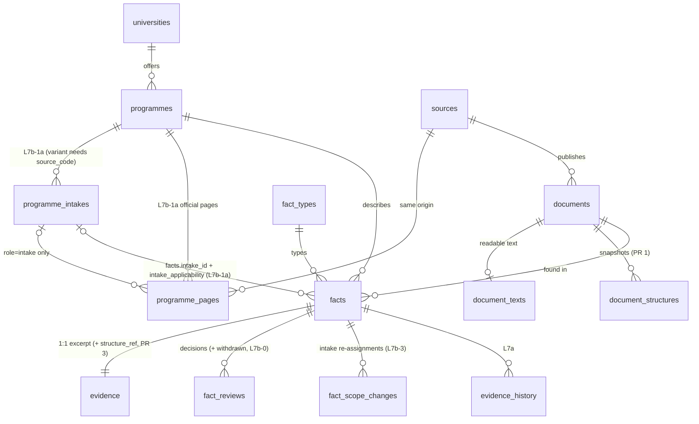
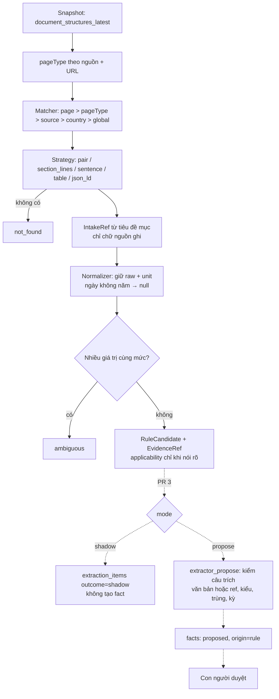
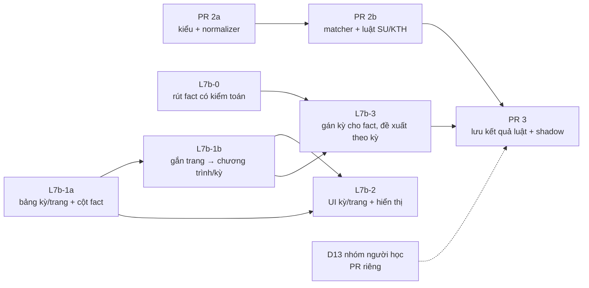

# L7b (Programme & Intake Identity) + PR 2 (Configurable Rule Engine): kiến trúc đã chốt và mức sẵn sàng

> **Chỉ là kiến trúc và kế hoạch.** Chưa sửa code, schema, migration hay dữ liệu; chưa tạo nhánh.
> Bản 2, ngày 2026-10-16: ghi lại D1–D12 (đã duyệt nguyên tắc), kiểm Risk A/B/C, chia lại backlog, đánh
> giá mức sẵn sàng. Cơ sở: `main` @ `dff3454`. Spec: `documents/NORDIC_CONFIGURABLE_EXTRACTION_IMPLEMENTATION_SPEC.md`
> (nhánh `docs/extraction-merge-wrapup`, PR #4).
>
> Ký hiệu:
> - **[Đã kiểm]**: thấy trực tiếp trong code, migration, test hoặc database (đọc chỉ-đọc);
> - **[Đề xuất]**: khuyến nghị kiến trúc, **chưa có** trong code;
> - **[Đã duyệt nguyên tắc]**: chủ dự án đã duyệt hướng đi, còn chờ kiểm khi làm;
> - **[Cần xác nhận]**: còn mở, hoặc là trở ngại kỹ thuật.

---

## 1. Hiện trạng

### 1.1 Định danh và gắn trang

| Thành phần | Hiện trạng | Bằng chứng |
|---|---|---|
| Trường | [Đã kiểm] `universities`; không trùng theo `(country_id, lower(name))` khi `status <> 'rejected'` | `20260923100000_education` (`universities_active_name_key`) |
| Chương trình | [Đã kiểm] `programmes`: một `official_url`; không trùng theo `(university_id, lower(name), degree_type)`; không có mã chương trình | `programmes_active_name_key` |
| Quyền | [Đã kiểm] `propose_programme()` cần `education.manage`; `review_education()` cần `facts.review` + khóa duyệt `919202604` | `20260923100000_education` |
| RLS chương trình | [Đã kiểm] `programmes_public`: `status='reviewed'` **và** trường đã duyệt; `programmes_editors`: `education.manage` / `facts.review` / `facts.propose` | như trên, dòng 102–108 |
| Gắn tài liệu | [Đã kiểm] `document_entity()` so `page_key(canonical_url)` với `official_url` đã duyệt; chỉ trả kết quả khi khớp **đúng 1** | `20261014090000_extraction_fact_types` |
| `page_key()` | [Đã kiểm] Hạ chữ thường host, bỏ `/` cuối, **giữ query string** | như trên |
| Phiên bản trang | [Đã kiểm] `page_documents()` = cùng `source_id` + `canonical_url` | `20261015100000_page_versions` |
| HTML gốc | [Đã kiểm] **Không lưu** (AGENTS.md §8); chỉ có `document_texts.text` và `document_structures` | `crawler/src/crawl.ts`, `db.ts`; `20261016090000_document_structures` |

### 1.2 Fact, ràng buộc và quy trình duyệt

| Thành phần | Hiện trạng | Bằng chứng |
|---|---|---|
| Ràng buộc thực thể | [Đã kiểm] `facts_single_entity`: tối đa 1 trong `university_id`, `programme_id`, `immigration_rule_id`, `occupation_id`; `facts_fact_type_country`: có loại thì phải có `country_id`; `facts_structured_needs_type`; `facts_ai_fields` | migration education, labour, fact_types, flexible_facts |
| Kỳ / thời hiệu | [Đã kiểm] `valid_from/valid_until` (ngày), `reference_period` (YYYY…, cho thống kê), `deadline_type`. **Không có kỳ nhập học, không có nhóm người học** | `Fact` |
| Câu trích (người biên tập) | [Đã kiểm] `propose_fact()`: câu trích phải có trong `document_texts.text` (qua `extraction_norm`) **nếu tài liệu có văn bản**; **không** giới hạn độ dài | `20261014110000_mapping_screen` |
| Câu trích (AI) | [Đã kiểm] `extractor_propose()`: 20–500 ký tự, nguyên văn trong văn bản, số phải có trong câu trích; chống trùng bằng `fact_duplicate_of()` | như trên |
| Duyệt | [Đã kiểm] `review_fact()`: **chỉ fact `proposed`** mới chuyển sang reviewed/rejected; fact đã duyệt chỉ có thể vào cặp `conflicted`. Ghi `fact_reviews` | `20260923090000_fact_conflict_requires_review` |
| Đổi loại | [Đã kiểm] `set_fact_type()`: **chỉ fact `proposed`**; ghi `fact_type_changes` (before/after jsonb) | `20261014100000_flexible_facts` |
| Nguồn đổi | [Đã kiểm] `resolve_source_change()`: chỉ cho fact đã bị đánh dấu `source_changed_at`; `revalidated` kiểm câu trích trong **văn bản** của phiên bản mới | `20261015100000_page_versions` |
| `fact_reviews.decision` | [Đã kiểm] CHECK ∈ reviewed, rejected, conflicted, revalidated, superseded | như trên |
| `extraction_items.outcome` | [Đã kiểm] CHECK ∈ proposed, invalid, duplicate, limit | `20260929090000_ai_extraction` |
| RLS fact | [Đã kiểm] `facts_public`: reviewed/conflicted (+ điều kiện riêng cho quy định nhập cư và nghề nghiệp); `facts_editors`: `facts.propose` / `facts.review` | `facts_public` mới nhất |
| So sánh quốc gia | [Đã kiểm] `/compare` lấy **mọi** fact đã duyệt có loại `comparable` theo `country_id` (`tuition_fee` là comparable) | `apps/web/app/(public)/(explore)/compare/page.tsx` dòng 76 |

### 1.3 Pipeline

| Thành phần | Hiện trạng | Bằng chứng |
|---|---|---|
| Worker AI | [Đã kiểm] `extractor_claim()` trả văn bản tài liệu; mỗi tài liệu gọi LLM một lần; mọi ứng viên đi qua `extractor_propose()` | `extractor/src/run.ts`, `db.ts` |
| Rule engine | [Đã kiểm] **Chưa có**; `extractor/src` = config, db, llm, prompt, run, validate, main | `ls extractor/src` |
| Gói dùng chung | [Đã kiểm] extractor đã phụ thuộc `@nordic/db` | `extractor/package.json` |
| Fixture cấu trúc | [Đã kiểm] `crawler/test/fixtures/structures/*.json` (crawler sinh ra, có test chống lệch) | `crawler/src/structure.fixtures.test.ts` |
| Bản trang thật cục bộ | [Đã kiểm] `crawler/test/real/snapshots/` có SU HT2026, SU HT2027, KTH ×2 (git bỏ qua) | `real-check` 80/80 |

### 1.4 Dữ liệu thật (đọc chỉ-đọc 2026-10-16)

- [Đã kiểm] 1 chương trình đã duyệt (SU SPROM), `official_url` = trang HT2026. Trang HT2027 chưa đăng ký crawl.
- [Đã kiểm] `programme_duration` đã duyệt với giá trị `31/08/2026 - 04/06/2028` (lịch học kỳ 2026, không phải
  thời lượng). Học phí 135000 SEK (`total`), "Closed for application", `application_period` đều không gắn kỳ.
- [Đã kiểm] Fact trùng đã duyệt: `application_period` ×2, `english_requirement` ×2, `prior_degree_requirement` ×3.
- [Đã kiểm] Câu "Tuition fee" của SU ghi "Applies to citizens from outside EU, EEA or Switzerland", nhưng fact
  học phí không mang thông tin này, và đang hiện trong `/compare` như học phí của Thụy Điển.

### 1.5 Cấu trúc trang thật (snapshot cục bộ; không chép nội dung vào repo)

- [Đã kiểm] **SU**: mỗi kỳ là một trang (`?semester=HT2027&eventcode=43003`). Thông tin chung của chương trình
  lặp lại trên mọi trang kỳ (15 cặp nhãn–giá trị). Thông tin riêng của kỳ nằm dưới tiêu đề "Autumn 2027 |
  Period 1 | Day-time, 50% | Only distance courses…". Trang **HT2026** có cả mục "Changes to the selection
  process for autumn 2027".
- [Đã kiểm] **KTH**: một trang cho cả chương trình; 0 cặp; hạn nằm dưới tiêu đề "Application deadlines for
  studies starting August 2027", dạng "15 January: Last day to apply" (**không ghi năm**); học phí ở trang khác.
- [Đã kiểm] Văn bản đọc được làm dính nhãn với giá trị (`Tuition feeFirst instalment…`): mốc PR 0.

---

## 2. Khoảng trống so với spec

| Spec | Trạng thái | Xử lý |
|---|---|---|
| §4/§7 Nội dung có cấu trúc | ✅ PR 1, PR 1.5 | — |
| §5 Định danh chương trình (mã) | ⚠️ | D4: `programmes.programme_code` (L7b-1a) |
| §5 Kỳ nhập học | ❌ | L7b-1a/1b |
| §5 Không ghi đè hạn 2027 bằng 2026 | ❌ | `facts.intake_id` + chống trùng theo kỳ (L7b-3) |
| §5 Học phí theo nhóm người học | ❌ | D13 [Cần xác nhận] |
| §5 derived / inferred | ❌ | D6, D7: chưa làm; PR 3 chỉ ghi `derivation` khi có quy tắc đã duyệt |
| §6 Rule engine | ❌ | PR 2a/2b (không database) |
| §6 CSS / XPath sau crawl | Không áp dụng | Không có HTML; luật chạy trên snapshot |
| §6 Ghi luật đã áp dụng | ❌ | PR 3 |
| §9 AI chỉ cho trường còn thiếu, xung đột giữa tài liệu | ❌ | PR 4 |
| Sửa fact đã duyệt có kiểm toán (D9, D3) | ❌ **Không có đường nào** | L7b-0 (mới) |

---

## 3. Quyết định đã chốt

### 3.1 Bảng quyết định

| # | Quyết định | Trạng thái | Kết quả kiểm kỹ thuật |
|---|---|---|---|
| D1 | Kỳ có `variant` tùy chọn; nhịp học / hình thức / địa điểm **không** tự thành định danh | [Đã duyệt nguyên tắc] | Tiêu chí ở 3.2; ràng buộc ở 4.2 |
| D2 | Hạn, kỳ nộp, trạng thái nhận hồ sơ, ngày bắt đầu/kết thúc: **thuộc kỳ**. Học phí, điều kiện: theo bằng chứng | [Đã duyệt nguyên tắc] | Cần trường "phạm vi áp dụng" riêng (Risk C, 4.4); không suy từ trang nơi tìm thấy |
| D3 | Fact cũ giữ `intake_id = NULL`; gán lại chỉ qua duyệt có kiểm toán | [Đã duyệt nguyên tắc] | **Hiện không có hàm nào sửa fact đã duyệt** → cần hàm mới (L7b-3) |
| D4 | Mã chương trình tùy chọn, có nguồn; không tự gộp | [Đã duyệt nguyên tắc] | Thuộc tính của `programmes`, không phải loại fact |
| D5 | Câu trích kiểm bằng văn bản **hoặc** phần tử snapshot theo `ref` | [Đã duyệt nguyên tắc] | Hợp đồng ở 3.3; đổi `extractor_propose()`, `resolve_source_change()`, `evidence` (PR 3). **[Cần xác nhận] D5a**: độ dài tối thiểu |
| D6 | Ngày không có năm: giữ chữ, không `value_date`, không suy năm | [Đã duyệt nguyên tắc] | Normalizer trả `null`; test bắt buộc |
| D7 | Chỉ quy đổi khi có quy tắc đã kiểm; giữ giá trị và đơn vị gốc; tách trực tiếp với suy ra | [Đã duyệt nguyên tắc] | PR 2 chỉ có phép đổi xác định (năm→tháng); không đổi hp↔ECTS, không suy thời lượng |
| D8 | Loại mới ưu tiên: `intake_start_date`, `intake_end_date`, `application_status`, `study_pace_percent` | [Đã duyệt nguyên tắc] | [Đã kiểm] cả 4 **chưa có** trong 19 loại hiện tại. Thêm qua `/admin/metrics` sau L7b-1a (cần cột `intake_scope`); thêm dữ liệu = ghi production → cần duyệt |
| D9 | Sửa `programme_duration` sai và fact trùng qua quy trình duyệt, giữ lịch sử, không SQL tay | [Đã duyệt nguyên tắc] | **[Đã kiểm] Quy trình hiện có không làm được**: `review_fact` / `set_fact_type` từ chối fact đã duyệt. Cần **L7b-0** (hàm rút fact có kiểm toán) → [Cần xác nhận] D9a |
| D10 | Nghiệm thu thật bằng SU HT2027 + KTH; đăng ký và crawl cần duyệt riêng | [Đã duyệt nguyên tắc] | PR 2b nghiệm thu được bằng **bản lưu cục bộ đã có**, không cần đăng ký. Đăng ký chỉ cần cho shadow (PR 3). Cấu hình đề xuất ở 6.3 |
| D11 | Luật là TypeScript trong repo, review qua PR; không bảng luật, không trình sửa luật, không mã do người dùng nhập | [Đã duyệt nguyên tắc] | Khớp PR 0 Q2 |
| D12 | Shadow trước khi luật được đề xuất fact; shadow không tạo fact | [Đã duyệt nguyên tắc] | Cần mở rộng `extraction_items.outcome` (PR 3). Tiêu chí ở 5.8 |
| **D13** | Nhóm người học cho học phí (EU/EEA/Thụy Sĩ hay ngoài) | **[Cần xác nhận]** | Lỗi có thật trong `/compare` (1.4). Đề xuất ở 4.4 |

### 3.2 D1: khi nào một biến thể là một kỳ riêng

**[Đề xuất]** Một biến thể chỉ là kỳ riêng khi nguồn cho thấy **một suất tuyển sinh riêng**. Phải có ít nhất
một bằng chứng sau, ghi rõ trong câu trích:

1. **Mã nộp hồ sơ / mã sự kiện riêng** do nguồn công bố (ví dụ `eventcode` khác nhau cho hai lựa chọn trong
   cùng học kỳ), **hoặc**
2. **Hạn nộp hoặc vòng xét tuyển riêng** cho lựa chọn đó, **hoặc**
3. **Trang chính thức riêng** chỉ mô tả lựa chọn đó.

Không thỏa điều nào → nhịp học, hình thức (từ xa / tại trường), địa điểm là **thuộc tính** của kỳ, lưu thành
fact (`study_pace_percent`, `study_mode`).

| Ví dụ | Kết quả |
|---|---|
| SU autumn 2027, "Day-time, 50%, distance", một eventcode | 1 kỳ, `variant = NULL`; 50% và distance là fact |
| Cùng học kỳ có 2 lựa chọn (tại trường / từ xa), mỗi lựa chọn có eventcode riêng | 2 kỳ, `variant` = "campus" / "distance", `source_code` khác nhau |
| Vòng xét tuyển 1 và 2 của cùng kỳ | **Không** phải kỳ riêng; là hạn nộp (fact) của cùng kỳ, ghi vòng trong chữ |
| Hai địa điểm, cùng một mã và một hạn | 1 kỳ; địa điểm là fact |

### 3.3 D5: hợp đồng kiểm câu trích theo snapshot

**[Đề xuất]** Ứng viên có thể kèm `evidence_ref = { structure_id, ref, field }`. Database kiểm theo thứ tự, mọi
bước đều bắt buộc:

1. `document_structures.id = structure_id` **và** `document_id` = tài liệu của yêu cầu trích xuất (cùng tài liệu,
   không phải phiên bản khác).
2. Phần tử có `ref` tồn tại **trong chính snapshot đó** (refs chỉ duy nhất trong một snapshot).
3. `field` chọn **một** chuỗi của **một** phần tử; danh sách đóng:
   - `heading.text`, `block.text`, `link.text`;
   - `pair.label`, `pair.value`, `pair.canonical` = `label + ": " + value` (cùng một phần tử, không ghép hai phần tử);
   - `table.cell[r][c]`;
   - **JSON-LD** (cập nhật 2026-10-16, review PR #6 M5): `ref = "sd<adapter>.<item>"` (mục
     `structuredData[adapter].items[item]`) + `path` (các khóa / chỉ số dẫn tới **một** giá trị chữ hoặc số). Chuỗi đã chọn
     là **giá trị tại đường dẫn đó**, không phải cả mục, nên giá trị nằm dưới một khóa khác không thể qua kiểm. Đường dẫn
     không tồn tại, hoặc trỏ tới object / mảng / chuỗi rỗng → không có ứng viên.
4. `extraction_norm(excerpt)` phải là chuỗi con của `extraction_norm(chuỗi đã chọn)`. Không có bước ghép nhiều
   phần tử, nên không thể tạo bằng chứng bằng cách nối các phần tử không liên quan.
5. Số trong giá trị phải có trong câu trích (giữ luật hiện tại).

**Tương thích ngược:** không có `evidence_ref` thì giữ nguyên kiểm theo văn bản. `propose_fact()` (người biên tập)
không đổi.

**Hàm phải đổi (PR 3, có migration):**
- `extractor_propose()`: nhận `evidence_ref`, gọi hàm kiểm nội bộ mới `structure_excerpt_ok()` (SECURITY DEFINER,
  không cấp cho `authenticated`);
- `evidence`: thêm `structure_id`, `structure_ref`, `structure_field` (NULL được), để truy vết;
- `resolve_source_change('revalidated')`: với bằng chứng theo `ref`, tìm lại **theo nội dung** trong snapshot mới
  nhất của phiên bản mới (refs không ổn định giữa các snapshot), rồi cập nhật `ref`;
- hàm mới `extractor_structure(p_run, p_request)` để worker đọc snapshot của tài liệu đã nhận, như
  `extractor_claim()` trả văn bản. Không cấp quyền đọc bảng cho `nordic_extractor_ops`.

**[Cần xác nhận] D5a, độ dài tối thiểu:** luật hiện tại là 20–500 ký tự. `pair.canonical` của "Language:
English" chỉ có 17 ký tự. Đề xuất: với bằng chứng theo `ref`, tối thiểu 3 ký tự và **phải** dùng
`pair.canonical` khi giá trị ngắn, để nhãn luôn đi kèm.

### 3.4 D12: tiêu chí chuyển từ shadow sang đề xuất (theo từng luật)

| # | Tiêu chí đo được |
|---|---|
| S1 | Ít nhất 2 lần chạy shadow liên tiếp trên mọi tài liệu trong phạm vi luật; tài liệu không đổi thì kết quả giống hệt (hash đầu ra) |
| S2 | 100% đầu ra qua toàn bộ kiểm tra của `extractor_propose()` ở chế độ thử (bằng chứng, kiểu, khoảng); 0 lỗi bằng chứng |
| S3 | So với fact đã duyệt cùng chương trình + loại + kỳ: 0 mâu thuẫn chưa giải thích; mọi khác biệt đều đã có người xem |
| S4 | 0 gán sai kỳ trên bộ nghiệm thu (SU HT2026, HT2027 gồm cả mục "autumn 2027" trên trang 2026, KTH ×2) |
| S5 | Số `not_found` / `ambiguous` / `intake_unresolved` được báo cáo; luật có `ambiguous` trong phạm vi thì không được chuyển |
| S6 | Chủ dự án duyệt bằng một PR đổi `mode: "propose"` cho đúng `id` + `version`. Tăng `version` thì luật **quay về shadow** |

---

## 4. L7b: mô hình dữ liệu (bản đã điều chỉnh)

### 4.1 Thay đổi so với bản 1

- Thêm `facts.intake_applicability` (Risk C): tách "tìm thấy ở đâu" với "áp dụng cho phạm vi nào".
- Thêm CHECK chặn lỗ hổng của khóa ngoại kép khi `programme_id` NULL (Risk B).
- Ràng buộc `variant` phải đi kèm `source_code` (Risk A).
- Thêm `start_month` (KTH ghi tháng, không ghi mùa).
- **Không đổi chữ ký** `document_entity()`; thêm hàm mới cho kỳ.
- Tách L7b-1 thành 1a (bảng) và 1b (gắn trang); thêm L7b-0 (rút fact có kiểm toán).

### 4.2 Risk A: định danh kỳ

**[Đã kiểm]** Với khóa `(programme_id, start_year, start_term, coalesce(variant,''))` của bản 1, nếu người
biên tập ghi "50% distance" vào `variant` thì sẽ có 2 kỳ cho cùng một đợt tuyển. Khóa **không** chặn được lỗi này.

**[Đề xuất] Mô hình tối thiểu:**

```sql
-- Ví dụ để review; chưa phải migration.
CREATE TABLE public.programme_intakes (
 id uuid PRIMARY KEY DEFAULT gen_random_uuid(),
 programme_id uuid NOT NULL REFERENCES public.programmes(id) ON DELETE RESTRICT,
 start_year int NOT NULL CHECK (start_year BETWEEN 2000 AND 2100),
 start_term text CHECK (start_term IN ('spring','summer','autumn','winter')),
 start_month int CHECK (start_month BETWEEN 1 AND 12),          -- khi nguồn ghi tháng (KTH "August")
 variant text CHECK (variant IS NULL OR length(btrim(variant)) BETWEEN 1 AND 80),
 source_code text CHECK (source_code IS NULL OR length(btrim(source_code)) BETWEEN 1 AND 40),
 label text NOT NULL,                                            -- nguyên văn, ví dụ "Autumn 2027"
 document_id uuid NOT NULL REFERENCES public.documents(id) ON DELETE RESTRICT,
 evidence_excerpt text NOT NULL,
 status text NOT NULL DEFAULT 'proposed' CHECK (status IN ('proposed','reviewed','rejected')),
 created_by uuid NOT NULL REFERENCES auth.users(id), created_at timestamptz NOT NULL DEFAULT now(), reviewed_at timestamptz,
 CONSTRAINT programme_intakes_when CHECK (start_term IS NOT NULL OR start_month IS NOT NULL),
 CONSTRAINT programme_intakes_variant_needs_code CHECK (variant IS NULL OR source_code IS NOT NULL),
 UNIQUE (id, programme_id)                                       -- đích của khóa ngoại kép
);
CREATE UNIQUE INDEX programme_intakes_identity ON public.programme_intakes
 (programme_id, start_year, coalesce(start_term,''), coalesce(start_month,0), coalesce(variant,'')) WHERE status <> 'rejected';
CREATE UNIQUE INDEX programme_intakes_code ON public.programme_intakes (programme_id, source_code)
 WHERE source_code IS NOT NULL AND status <> 'rejected';
```

- Mùa và tháng đều là chữ **nguồn ghi**. Không tự đổi "August" thành "autumn".
- `propose_intake()` từ chối khi đã có kỳ cùng năm + mùa/tháng mà không có `variant`/`source_code` khác. Đây là
  cảnh báo trùng; người duyệt quyết.
- Khớp kỳ do luật tìm thấy (PR 3): theo `(năm, mùa)` hoặc `(năm, tháng)`. Nếu site cần ánh xạ tháng → mùa thì
  khai báo rõ trong cấu hình site, review qua PR; không khớp thì báo `intake_unresolved`.

### 4.3 Risk B: toàn vẹn tham chiếu của fact

**[Đã kiểm] Lỗ hổng:** khóa ngoại kép mặc định là `MATCH SIMPLE`: chỉ cần **một** cột NULL là Postgres
**bỏ qua** kiểm tra. Fact có `intake_id` nhưng `programme_id = NULL` sẽ lọt qua. Còn `MATCH FULL` thì không dùng
được, vì nó cấm cả fact cấp chương trình (`programme_id` có, `intake_id` NULL).

**[Đề xuất]** `MATCH SIMPLE` + CHECK:

```sql
ALTER TABLE public.facts
 ADD COLUMN intake_id uuid,
 ADD COLUMN intake_applicability text CHECK (intake_applicability IN ('programme','intake')),
 ADD CONSTRAINT facts_intake_fk FOREIGN KEY (intake_id, programme_id)
   REFERENCES public.programme_intakes (id, programme_id) ON DELETE RESTRICT,
 ADD CONSTRAINT facts_intake_needs_programme CHECK (intake_id IS NULL OR programme_id IS NOT NULL),
 ADD CONSTRAINT facts_intake_applicability CHECK (
   (intake_applicability = 'intake'    AND intake_id IS NOT NULL) OR
   (intake_applicability = 'programme' AND intake_id IS NULL AND programme_id IS NOT NULL) OR
   (intake_applicability IS NULL       AND intake_id IS NULL));
CREATE INDEX facts_intake_idx ON public.facts(intake_id) WHERE intake_id IS NOT NULL;
```

| Trường hợp | Kết quả |
|---|---|
| Fact cấp chương trình | `programme_id` có, `intake_id` NULL → hợp lệ |
| Fact cấp trường / quốc gia / nhập cư / nghề nghiệp | `programme_id` NULL, `intake_id` NULL → hợp lệ, không đổi |
| Fact có kỳ nhưng `programme_id` NULL | Bị CHECK `facts_intake_needs_programme` chặn |
| Fact gắn kỳ của chương trình khác | Bị khóa ngoại kép chặn |
| `facts_single_entity` | Không đổi: kỳ là con của chương trình, không phải thực thể thứ năm |
| Dữ liệu cũ | Mọi dòng: `intake_id` NULL, `intake_applicability` NULL → thỏa mọi CHECK; không cần backfill |
| `propose_fact`, `extractor_propose`, `review_fact`, `set_fact_type`, `resolve_source_change` | Câu INSERT liệt kê cột tường minh → cột mới mặc định NULL; không phải sửa trong L7b-1a |
| Đổi `programme_id` của fact đã gắn kỳ | Khóa ngoại kép chặn. Hiện **không** có hàm nào đổi `programme_id` ([Đã kiểm] danh sách `UPDATE public.facts SET`) |
| RLS | Chính sách của `facts` lọc theo dòng và trạng thái, không theo cột → không đổi. Bảng mới có RLS riêng (4.5) |

### 4.4 Risk C: nơi tìm thấy ≠ phạm vi áp dụng

| Câu hỏi | Lưu ở đâu | Trạng thái |
|---|---|---|
| 1. Tìm thấy ở đâu? | `facts.document_id` + `evidence` (+ `structure_ref` ở PR 3) | [Đã kiểm] có |
| 2. Nói về chương trình nào? | `facts.programme_id` | [Đã kiểm] có |
| 3a. Áp dụng cho kỳ nào? | `facts.intake_id` + `facts.intake_applicability` | [Đề xuất] L7b-1a |
| 3b. Áp dụng cho giai đoạn nào? | `valid_from` / `valid_until` **khi nguồn ghi rõ** (ví dụ năm học) | [Đã kiểm] cột có sẵn |
| 3c. Áp dụng cho nhóm người học nào? | **Chưa có** | **[Cần xác nhận] D13** |

**Ý nghĩa của `intake_applicability`:**
- `intake`: nguồn nói rõ thông tin chỉ cho kỳ đó (ví dụ nằm dưới tiêu đề "Autumn 2027", hay "Application
  deadlines for studies starting August 2027");
- `programme`: nguồn nói rõ thông tin áp dụng chung cho chương trình;
- `NULL`: **chưa xác định**. Đây là trạng thái của mọi fact cũ và của đề xuất mới khi không có bằng chứng rõ.

Học phí trên trang Autumn 2027 của SU mà không có câu nào giới hạn theo kỳ → `NULL`, **không** tự thành
`intake`. Giao diện hiển thị "phạm vi: chưa xác định". `fact_types.intake_scope` chỉ là **gợi ý** cho giao diện và
luật (loại nào thường thuộc kỳ), không tự gán.

**D13 [Cần xác nhận]: đề xuất tối thiểu, PR riêng sau L7b-1a:**
`facts.applicant_group text NULL CHECK (applicant_group IN ('all','eu_eea_ch','non_eu_eea_ch'))`, chỉ đặt khi câu
trích nói rõ; `/compare` hiện nhóm cạnh giá trị và không gộp các nhóm. Không làm khung "phạm vi áp dụng" tổng quát.

### 4.5 Bảng `programme_pages` và RLS

```sql
CREATE TABLE public.programme_pages (
 id uuid PRIMARY KEY DEFAULT gen_random_uuid(),
 programme_id uuid NOT NULL REFERENCES public.programmes(id) ON DELETE RESTRICT,
 intake_id uuid,
 source_id uuid NOT NULL REFERENCES public.sources(id) ON DELETE RESTRICT,
 url text NOT NULL,
 role text NOT NULL CHECK (role IN ('programme','intake','fees','admissions','curriculum')),
 status text NOT NULL DEFAULT 'proposed' CHECK (status IN ('proposed','reviewed','rejected')),
 created_by uuid NOT NULL REFERENCES auth.users(id), created_at timestamptz NOT NULL DEFAULT now(), reviewed_at timestamptz,
 FOREIGN KEY (intake_id, programme_id) REFERENCES public.programme_intakes(id, programme_id) ON DELETE RESTRICT,
 CHECK ((role = 'intake') = (intake_id IS NOT NULL))
);
CREATE UNIQUE INDEX programme_pages_key ON public.programme_pages(programme_id, public.page_key(url)) WHERE status <> 'rejected';
```

- `url` phải cùng origin với `sources.canonical_url` (kiểm trong hàm đề xuất, giống `save_crawl_target`).
  Đăng ký trang **không** tạo `crawl_target`; crawl vẫn cần đăng ký riêng và được duyệt.
- RLS cho cả 2 bảng, theo mẫu `programmes`:
  - `*_public`: `status='reviewed'` và chương trình đã duyệt (cùng điều kiện như `programmes_public`);
  - `*_editors`: `education.manage` / `facts.review` / `facts.propose`;
  - ghi **chỉ** qua hàm SECURITY DEFINER (`propose_intake`, `propose_programme_page`: `education.manage`;
    duyệt qua `review_education()` mở rộng loại: `facts.review`).

### 4.6 Sơ đồ ER



---

## 5. PR 2: Rule Engine (không database)

### 5.1 Xác nhận không cần thay đổi database production

[Đã kiểm] PR 2a và 2b chỉ thêm:
- code trong `extractor/src/rules/`;
- kiểu dùng chung trong `@nordic/db` (chỉ TypeScript);
- fixture tổng hợp.

Worker không gọi engine (`run.ts` không đổi), và không có migration. Nghiệm thu thật dùng snapshot cục bộ đã có.

### 5.2 Hợp đồng dùng chung (`packages/db/src/rule-output.ts`) [Đã kiểm: đã có trong code]

> Bản cuối sau PR 2a (#5, merge `1c5d93c`) và review PR #6. Khác bản đề xuất ban đầu:
> - `EvidenceRef` là union: `cell` chỉ khi `field = "cell"`; `field = "json_ld"` mang `path` (M5, PR #6);
> - `IntakeRef` phải có mùa hoặc tháng; `from: "page"` mang id bản ghi L7b thay vì bằng chứng snapshot;
> - `RuleIssue.intakeText` cho kỳ không giải được;
> - `evidenceRefProblems()` / `intakeRefProblems()` kiểm dữ liệu dựng từ JSON.

```ts
type IntakeWhen = { term: IntakeTerm; month: number | null } | { term: null; month: number };   // không bao giờ thiếu cả hai
export type IntakeRef = { label: string; year: number } & IntakeWhen & (
  | { from: "heading"; evidence: EvidenceRef }                                   // heading trong snapshot này
  | { from: "page"; record: { programmePageId: string; intakeId: string } }     // bản ghi L7b đã duyệt (PR 3)
);
type EvidenceBase = { documentId: string; structureId: string | null; structureHash: string; ref: string; excerpt: string };
export type EvidenceRef =
  | (EvidenceBase & { field: "text" | "label" | "value" | "canonical" })
  | (EvidenceBase & { field: "cell"; cell: readonly [number, number] })
  | (EvidenceBase & { field: "json_ld"; path: readonly (string | number)[] });
export type RuleCandidate = {
  kind: "candidate";
  ruleId: string; ruleVersion: number; rulesetVersion: string;
  factType: string;                               // key trong fact_types
  method: "pair" | "section_lines" | "sentence" | "table" | "json_ld";
  raw: { text: string; unit: string | null };     // luôn giữ
  normalized: { number: string | null; currency: string | null; period: ValuePeriod | null; date: string | null; unit: string | null } | null;
  derivation: null;                               // PR 2: chỉ trích trực tiếp (D7)
  intake: IntakeRef | null;
  applicability: "intake" | "programme" | null;   // chỉ khi bằng chứng nói rõ (Risk C)
  evidence: EvidenceRef;
  notes: string[];                                // lý do bỏ phần chuẩn hóa, như adjustments
};
export type RuleIssue = {
  kind: "not_found" | "ambiguous" | "intake_unresolved" | "normalize_failed";
  factType: string; ruleIds: string[]; detail: string; candidates?: RuleCandidate[];
  intakeText?: string;                            // chữ về kỳ không giải được, nguyên văn
};
export type RuleOutput = RuleCandidate | RuleIssue;
```

### 5.3 Kiểu luật và kiểm cấu hình

- `Rule = { id, version, enabled, mode: "shadow" | "propose", scope, field, strategy, normalize, intake, evidence, overrides? }`;
  `mode` mặc định `shadow`.
- Kiểm lúc test (không lúc chạy):
  - `id` duy nhất;
  - `field` thuộc danh sách loại fact đã biết (bảng tĩnh trong repo, có test so với danh sách đã duyệt);
  - regex biên dịch được và có neo;
  - `overrides` trỏ tới luật có thật;
  - không có hai luật cùng phạm vi + cùng field + cùng priority.
- Dấu vân tay: hash của định nghĩa luật phải khớp bảng `versions.ts`; sửa mà không tăng `version` → test fail.

### 5.4 Khớp và ưu tiên

- Độ cụ thể: `page` > `pageType` > `source` > `country` > `global`. Cùng mức thì xét `priority`, rồi `id`.
- Với mỗi `(field, intake)`: dùng mức cụ thể nhất có kết quả. Luật cùng mức ra giá trị khác nhau →
  `ambiguous` (giữ mọi ứng viên). Không chọn theo "lớn nhất" hay "mới nhất".
- Ứng viên trùng (cùng field + kỳ + giá trị chuẩn hóa + ref) → gộp, giữ luật cụ thể nhất.

### 5.5 Chuẩn hóa (theo D6, D7)

| Normalizer | Làm | Không làm |
|---|---|---|
| `duration` | "2 years" / "two-year" → 24 tháng (`normalized.unit = "months"`), giữ chữ gốc | Không lấy từ tên ("One Year Master’s"); không suy từ tín chỉ / nhịp học |
| `credits` | "120 ECTS credits" → 120, unit `ECTS`; "60 credits" → 60, unit `credits` (đúng chữ nguồn) | Không đổi hp → ECTS |
| `money` | số + tiền tệ + kỳ; một câu nhiều khoản → nhiều ứng viên | Không cộng, chia; không gán phí chung |
| `date` | Có năm → `date`; "16 October (2026)" → `2026-10-16` | Không có năm → `date = null` + note (D6) |
| `pace` | "50%" → 50 | — |

### 5.6 Tính tất định

Hàm thuần: đầu vào là `{ documentId, structureId, structureHash, structure, pageUrl, source, country }`. Không
`Date.now`, không mạng, không ngẫu nhiên. Đầu ra sắp xếp theo `(factType, intake, ruleId, ref)`. Test: chạy 2 lần
→ giống hệt; đổi thứ tự luật trong registry → giống hệt.

### 5.7 Nghiệm thu PR 2b

- **Fixture tổng hợp:** SU-like (đã có `programme-sidebar`) + **KTH-like mới** (không cặp, hạn trong khối nhiều
  dòng dưới tiêu đề kỳ). Thêm vào `crawler/test/fixtures/` và sinh JSON bằng `structure-fixtures`.
- **Cục bộ, trang thật:** `npm run rules:check -w @nordic/extractor` trên 4 snapshot đã có; kỳ vọng ghi từ nội
  dung thật, giống cách `real-check` làm.
- **Bắt buộc:**
  - cùng field lấy được từ SU-like (pair) và KTH-like (section_lines) chỉ bằng cấu hình;
  - mục "autumn 2027" trên trang HT2026 **không** gán cho kỳ 2026;
  - "15 January" → `date = null`;
  - học phí SU → `applicability = null` (không có câu giới hạn theo kỳ);
  - mỗi ứng viên có `EvidenceRef` thỏa hợp đồng 3.3 (kiểm bằng bản TypeScript của cùng thuật toán).

### 5.8 Luồng thực thi



---

## 6. Backlog và mức sẵn sàng

### 6.1 Thứ tự và phụ thuộc



Không có phụ thuộc vòng. PR 2 và L7b chỉ chung kiểu TypeScript `IntakeRef`; kiểu này nằm trong PR 2a.

### 6.2 Chi tiết từng PR

#### L7b-0: Rút fact đã duyệt có kiểm toán (migration nhỏ) [Đề xuất]
- **Phạm vi:** hàm `withdraw_fact(p_fact, p_note, p_related DEFAULT NULL)`, cần `facts.review`, khóa duyệt
  `919202604`:
  - chuyển `reviewed` / `conflicted` → `rejected`;
  - ghi `fact_reviews` với `decision = 'withdrawn'` (mở rộng CHECK) và `related_fact_id` khi rút vì trùng;
  - nút "Rút" ở `/facts/workspace` cho fact đã duyệt.
- **Dùng cho D9:** rút `programme_duration` sai (ghi chú: là lịch học kỳ 2026); rút các bản trùng, trỏ tới bản giữ lại.
- **Ảnh hưởng:** không đổi `review_fact`, `set_fact_type`. `fact_reviews` thêm một giá trị quyết định.
- **Tương thích:** chỉ thêm. **RLS:** `fact_reviews` hiện chỉ cho đọc; ghi qua hàm.
- **Nghiệm thu:**
  - chỉ `facts.review` gọi được;
  - fact `proposed` dùng `review_fact`, không dùng hàm này;
  - fact đã rút biến mất khỏi trang công khai;
  - lịch sử còn đủ;
  - không rút được fact đang có `source_changed_at` (dùng `resolve_source_change`).
- **Test:** PGlite theo vai trò; render workspace.
- **Hoàn tác:** forward-fix: `DROP FUNCTION`, giữ dòng `fact_reviews`.

#### L7b-1a: Bảng kỳ, trang, cột fact (migration) [Đề xuất]
- **Phạm vi:**
  - `programme_intakes`, `programme_pages` (4.2, 4.5);
  - `facts.intake_id`, `facts.intake_applicability` + CHECK (4.3);
  - `programmes.programme_code` (NULL, UNIQUE theo trường khi không bị từ chối);
  - `fact_types.intake_scope` (`none` / `optional` / `intake`) + đặt giá trị cho các loại hiện có trong migration;
  - `propose_intake()`, `propose_programme_page()`;
  - `review_education()` thêm loại `intake` / `programme_page` (giữ chữ ký);
  - RLS 2 bảng mới;
  - `schema.prisma`.
- **Không đổi:** `document_entity`, `fact_duplicate_of`, `extractor_propose`, `propose_fact`, `page_key`.
- **Nghiệm thu:**
  - mọi ràng buộc ở 4.2–4.5 có test âm (chèn sai bị chặn);
  - fact cũ không đổi;
  - `anon` chỉ thấy kỳ / trang đã duyệt của chương trình đã duyệt;
  - `db-schema-drift.test.ts` qua.
- **Hồi quy:** toàn bộ test web / crawler / extractor; `extractor_propose` cũ vẫn chèn được.
- **Hoàn tác:** forward-fix có test (bỏ ràng buộc, cột, bảng, hàm theo thứ tự ngược) như PR 1.

#### L7b-1b: Gắn trang → chương trình / kỳ (migration: thay thân hàm) [Đề xuất]
- **Phạm vi:**
  - `document_entity()` giữ **chữ ký**, thêm nhánh khớp `programme_pages` đã duyệt (vẫn "khớp đúng 1 chương trình");
  - hàm mới `document_intake(p_document)` trả `intake_id` khi trang có `role = 'intake'`;
  - `editor_document_entity()` trả thêm kỳ qua hàm mới (giữ chữ ký cũ, thêm hàm editor mới).
- **Tác động hành vi:** sau khi duyệt trang HT2027, đề xuất AI trên trang đó **sẽ gắn chương trình**. AI
  **không** tự gán kỳ (D2).
- **Nghiệm thu:**
  - trang có 2 chương trình → rỗng;
  - trang đã bị từ chối → không khớp;
  - tài liệu HT2026 cũ vẫn khớp qua `official_url`.
- **Phụ thuộc:** L7b-1a đã chạy trên production.

#### L7b-2: Giao diện (không migration) [Đề xuất]
- **Phạm vi:**
  - workspace giáo dục: đề xuất / duyệt kỳ, trang, mã chương trình;
  - `/admin/metrics`: hiện và đặt `intake_scope` (có thể cần `save_fact_type` thêm tham số → nếu cần thì
    chuyển phần này vào L7b-1a);
  - trang chương trình công khai: nhóm fact theo kỳ, "phạm vi: chưa xác định", "áp dụng chung".
- **Nghiệm thu:**
  - quyền đúng như `programmes`;
  - public không thấy kỳ chưa duyệt;
  - không hiển thị "Official/Verified" sai (AGENTS.md §15).

#### L7b-3: Gán kỳ / phạm vi cho fact (migration) [Đề xuất]
- **Phạm vi:**
  - bảng `fact_scope_changes` (append-only: fact, actor, before, after, note);
  - hàm `set_fact_scope(p_fact, p_intake, p_applicability, p_note)`: `facts.review`; fact đã duyệt cũng được
    nhưng bắt buộc ghi chú; kiểm kỳ thuộc đúng chương trình;
  - `propose_fact()` thêm `p_intake`, `p_applicability` (DROP + CREATE, nêu lại GRANT, cập nhật action);
  - `fact_duplicate_of()` thêm bản có `p_intake`; bản 6 tham số cũ gọi bản mới với NULL;
  - ô chọn kỳ ở `/facts/map/[id]` và workspace.
- **Vì sao cần chống trùng theo kỳ:** [Đã kiểm] trang KTH là một URL cho mọi năm, nên "15 January" của 2027 và
  2028 sẽ bị coi là trùng nếu không có kỳ.
- **Nghiệm thu:**
  - gán kỳ của chương trình khác bị chặn;
  - mọi thay đổi có dòng lịch sử;
  - đề xuất AI không đổi hành vi.
- **Phụ thuộc:** L7b-1b; L7b-0 (dọn dữ liệu trước khi gán).

#### PR 2a: Kiểu + normalizer (không migration) [Đề xuất]
- **Phạm vi:**
  - `packages/db/src/rule-output.ts` (5.2), export trong `package.json` của `@nordic/db`;
  - `extractor/src/rules/types.ts`, `normalizers/{duration,credits,money,date,pace}.ts` + test bảng;
  - test cấu hình.
- **Nghiệm thu:**
  - mọi dòng "làm / không làm" ở 5.5 có test;
  - ngày không năm → `null`;
  - giá trị gốc luôn được giữ.
- **Hồi quy:** extractor 15, web, crawler; `next build` (không import chéo workspace, bài học PR 1.5).

#### PR 2b: Matcher, strategy, luật SU + KTH (không migration) [Đề xuất]
- **Phạm vi:**
  - `matcher.ts`, `strategies/*`, `intake.ts`, `engine.ts`, `registry`, `sites/su.ts`, `sites/kth.ts`, `versions.ts`;
  - fixture KTH-like;
  - script `rules:check` cục bộ.
- **Nghiệm thu:** 5.7.
- **Phụ thuộc:** PR 2a.

#### PR 3: Lưu kết quả luật + shadow (migration) [Đề xuất]
- **Phạm vi:**
  - `facts.origin` thêm `rule`; `rule_id`, `rule_version`, `derivation`;
  - `evidence.structure_*`; `structure_excerpt_ok()`; `extractor_structure()`;
  - `extractor_propose` theo 3.3;
  - `resolve_source_change` tìm lại theo nội dung;
  - `extraction_items.outcome` thêm `shadow`, `not_found`, `ambiguous`, `intake_unresolved`;
  - `run.ts` chạy luật trước AI.
- **Phụ thuộc:** L7b-1b, L7b-3, PR 2b, D5a, D13 (cho học phí), đăng ký nguồn (D10).

### 6.3 Cấu hình nguồn đề xuất cho D10 (chỉ để review; chưa đăng ký)

| Mục | Đề xuất | Ai quyết |
|---|---|---|
| SU HT2027 | `crawl_target` dưới nguồn "Stockholm University" đã có: `https://www.su.se/english/education/course-catalogue/sp/sprom?semester=HT2027&eventcode=43003`, `kind=page`, trình duyệt bật | Chủ dự án |
| Nguồn KTH | Tên, URL gốc, tier, `crawl_policy`, trạng thái xác minh: **chủ dự án điền** (Claude không tự điền thông tin nguồn) | Chủ dự án |
| URL KTH | `https://www.kth.se/en/studies/master/industrial-management`, `https://www.kth.se/en/studies/master/interactive-media-technology` (đã kiểm robots ngày 2026-10-15 khi chụp bản cục bộ) | Chủ dự án |
| Trang phí KTH | **Chưa có URL**; cần chủ dự án cung cấp, không đoán | Chủ dự án |

### 6.4 Ma trận sẵn sàng

| PR | Nhãn | Điều kiện / lý do |
|---|---|---|
| **PR 2a** | **READY** | Không database, không production; quyết định cần thiết đã duyệt |
| **L7b-0** | **READY WITH CONDITIONS** | D9a (chấp nhận hàm `withdraw_fact` + quyết định `withdrawn`); cổng migration (6.5) |
| **L7b-1a** | **READY WITH CONDITIONS** | Duyệt SQL ở 4.2–4.5 (nhất là `intake_applicability`, `variant_needs_code`); cổng migration |
| **L7b-1b** | **READY WITH CONDITIONS** | L7b-1a đã áp dụng và kiểm sau; cổng migration |
| **PR 2b** | **READY WITH CONDITIONS** | PR 2a merge; fixture KTH-like tổng hợp; nghiệm thu thật cục bộ |
| **L7b-2** | **READY WITH CONDITIONS** | L7b-1a (+1b cho phần gắn trang) đã áp dụng |
| **L7b-3** | **READY WITH CONDITIONS** | L7b-1b, L7b-0 đã áp dụng; cổng migration |
| **PR 3** | **BLOCKED** | Cần D5a, D13, L7b-3, PR 2b, và duyệt đăng ký nguồn (D10) |

### 6.5 Cổng production cho mọi PR có migration (L7b-0, 1a, 1b, 3, PR 3)

| # | Bước | Ghi chú |
|---|---|---|
| 1 | Kiểm trước chỉ-đọc: migration đang chờ, migration lỗi, đối tượng sắp tạo chưa tồn tại, phiên bản Postgres, vai trò | Claude chạy, chỉ đọc |
| 2 | **`pg_dump` mới + `pg_restore --list`** ngay trước khi chạy | **Bắt buộc**: gói Free không có bản sao lưu. Không coi lần trước thành công là đã có sao lưu |
| 3 | Chủ dự án **duyệt rõ** cho đúng migration đó | — |
| 4 | Migration trong `BEGIN … COMMIT` | Test PGlite: lỗi giữa chừng → không có gì được áp dụng |
| 5 | Kiểm sau: RLS bật, quyền hàm, `anon`, checksum khớp file | Như PR 1 |
| 6 | Forward-fix có test (áp dụng → gỡ → áp dụng lại, dữ liệu cũ nguyên vẹn) | File trong `prisma/recovery/` |
| 7 | Test RLS / quyền theo vai trò (Administrator, Editor, AI Draft, Member, `anon`) | PGlite |
| 8 | Merge sau migration; mỗi merge = deploy production → cần duyệt | — |

---

## 7. Quyết định còn mở

| # | Câu hỏi | Đề xuất |
|---|---|---|
| D5a | Độ dài tối thiểu của câu trích khi kiểm theo `ref` | ≥ 3 ký tự, bắt buộc `pair.canonical` khi giá trị ngắn |
| D9a | Chấp nhận hàm mới `withdraw_fact` (quyết định `withdrawn`) vì quy trình hiện có không rút được fact đã duyệt | Chấp nhận (L7b-0) |
| D13 | Thêm `facts.applicant_group` để học phí ngoài EU không bị so như học phí chung | Có, PR riêng sau L7b-1a, trước PR 3 |
| D10b | Thông tin nguồn KTH và URL trang phí KTH | Chủ dự án cung cấp khi muốn chạy shadow |

## 8. Bằng chứng đã kiểm

**Migration và hàm:**
- `20260923100000_education`: `universities_active_name_key`, `programmes_active_name_key`, `propose_programme`,
  `review_education`, chính sách `programmes_public` / `programmes_editors`;
- `20260923090000_fact_conflict_requires_review`: `review_fact`;
- `20261014090000_extraction_fact_types`: `page_key`, `document_entity`;
- `20261014100000_flexible_facts`: `set_fact_type`, `fact_type_changes`, `save_fact_type`, `facts_structured_needs_type`;
- `20261014110000_mapping_screen`: `propose_fact`, `extractor_propose`, `editor_document_entity`;
- `20261015100000_page_versions`: `page_documents`, `fact_duplicate_of`, `resolve_source_change`,
  `fact_reviews_decision_check`;
- `20260929090000_ai_extraction`: `extractor_claim`, CHECK `extraction_items.outcome`;
- `20261016090000_document_structures`;
- danh sách `UPDATE public.facts SET` và mọi CHECK `facts_*` trên toàn bộ migration.

**Code:**
- `packages/db/prisma/schema.prisma` (University, Programme, Fact, FactType, Evidence, Document, CrawlTarget, ExtractionItem);
- `extractor/src/{run,validate,prompt,db}.ts`, `extractor/package.json`;
- `apps/web/lib/education/programme-slots.ts`;
- `apps/web/app/(public)/(explore)/compare/page.tsx`;
- `crawler/src/structure.ts`, `crawler/test/fixtures/structures/`, `crawler/test/real/expectations.json`.

**Database (chỉ đọc, 2026-10-16):** `programmes`, `fact_types` (19 loại), các fact gắn chương trình.

**Trang thật (snapshot cục bộ):** SU HT2026, SU HT2027, KTH Industrial Management, KTH Interactive Media Technology.

---

## 9. Cập nhật sau review PR #6 (PR 2b, 2026-10-16)

- **Mức ưu tiên theo loại fact + kỳ** (M2): ứng viên của các kỳ khác nhau không gạt nhau; kỳ không giải được là
  issue riêng, không lẫn với giá trị cấp chương trình. Issue không bao giờ bị bỏ vì thứ tự ưu tiên.
- **Mã phiên bản bộ luật** (M4) = luật + định nghĩa loại trang + `INTAKE_SCOPE` + `ENGINE_VERSION` (tăng tay khi
  code của engine/normalizer đổi kết quả). `RULESET_LOCK` trong registry bắt buộc cập nhật cùng thay đổi.
- **Bằng chứng JSON-LD** (M5): mục 3.3 và 5.2 ở trên.
- **[Cần xác nhận] M1, dấu vết ứng viên bị gạt:** hợp đồng hiện tại không biểu diễn được có cấu trúc (chỉ có
  `notes` dạng chữ). Đề xuất mở rộng nhỏ nhất, tương thích ngược (trường tùy chọn):

  ```ts
  export type Suppression = {
    reason: "lower_specificity" | "lower_priority";
    candidate: RuleCandidate;        // giá trị, rule id/version, bằng chứng của ứng viên bị gạt, giữ nguyên
  };
  // RuleCandidate thêm:
  suppressed?: Suppression[];        // chỉ những ứng viên có CÂU KHÁC ứng viên thắng (cùng loại fact + kỳ)
  ```
  Quy tắc PR 3: ứng viên có `suppressed` không rỗng là **mâu thuẫn chưa giải quyết** → không tự đề xuất, chuyển
  người duyệt. Cùng mức + cùng priority vẫn là `ambiguous` như hiện nay.
