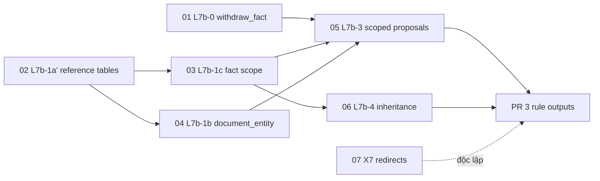

# L7b V3: Final Architecture Gate

> **Chỉ là thiết kế và SQL đề xuất.** Chưa chạy migration nào trên database dùng chung, chưa sửa dữ liệu, chưa đăng
> ký nguồn, chưa crawl, chưa commit. Ngày: 2026-10-16. Cơ sở: `main` @ `e0c4e61`.
> Tài liệu liên quan: `l7b-architecture-v3.md`, `cross-university-compatibility-review.md`, `l7b-pr2-architecture-review.md`.
> SQL đề xuất: `docs/architecture/l7b-v3-sql/` (**ngoài** `prisma/migrations`, nên `prisma migrate deploy` không thấy).

## 0. Tóm tắt

- **3 file migration chính xác** (01 L7b-0, 02 L7b-1a', 03 L7b-1c) + **3 file forward-fix**. Cả 6 đã được **kiểm trên
  PGlite trong bộ nhớ** (PostgreSQL 17.5; production 17.6), không đụng database thật: **121/121 đạt**.
- Việc kiểm thử đã bắt được **1 lỗi thật trong SQL đề xuất**, và lỗi này đã được sửa: `set_fact_scope` dùng
  `v_needed || 'intake'`, nên `'intake'` bị đọc như một mảng (lỗi `malformed array literal`); nay dùng
  `array_append`. Lúc viết V3 cũng phát hiện và sửa **2 CHECK có lỗ hổng NULL**.
- Các migration sau (04–07) có **thiết kế và DDL chính**, nhưng chưa có file chính xác. Lý do: chúng thay thân các hàm
  hiện có (`document_entity`, `propose_fact`, `fact_duplicate_of`) và mã crawler, nên phải viết lại trên bản hiện hành
  trong PR riêng.
- **Khuyến nghị:** **GO** cho việc viết PR triển khai 01–03 (vào repo, có test PGlite thật). **NO-GO** cho việc chạy
  bất kỳ migration nào lên production cho tới khi qua đủ cổng ở §7.

---

## 1. Sổ quyết định (cập nhật)

| # | Quyết định | Trạng thái | Điều kiện gate áp vào | Trong V3 |
|---|---|---|---|---|
| X1 | Phạm vi fact cho mọi loại fact (kỳ, nhóm, vòng, năm học) | Duyệt thiết kế | 1, 2, 8, 9, 10 | `facts.*_scope`, nhãn nguyên văn; "chưa nói" = NULL, **không bao giờ** = tất cả |
| X2 | Fact cấp trường / quốc gia + kế thừa có điều kiện | Duyệt thiết kế | 3 | `fact_types.scope_levels` (03). Kế thừa **không** dựa vào bậc học: cần duyệt **từng fact cho từng chương trình** (L7b-4, §4) |
| X3 | `official_pages` + `official_page_links` | Duyệt thiết kế | 11 | 02 |
| X4 | Ngày không năm: chỉ chữ | Duyệt | 4 | Không có cột ngày lặp lại; normalizer và engine giữ `unresolved` |
| X5 | Học phí theo tín chỉ: `unresolved` | Duyệt | 4 | Không thêm kỳ thu `per_credits` |
| X6 | Cổng quốc gia: fact cấp quốc gia + vòng tuyển | Duyệt **kiến trúc**; **không** được đăng ký nguồn hay crawl | 5 | `official_pages.country_id`, `role='portal'`, `admission_round_label`. Chưa có dữ liệu |
| X7 | Ghi URL đích khi chuyển hướng | Duyệt thiết kế | 6 | Migration 07 + đổi crawler (§4): ghi URL đích, kiểm theo chính sách nguồn tin cậy |
| X8 | Mẫu nghiệm thu: KU, UiO, Helsinki, TU Delft | Duyệt chọn mẫu; **không** đăng ký | 5 | Fixture tổng hợp F1–F7 (V3 §7) |
| X9 | Nội dung cần tương tác: không hỗ trợ | Duyệt | 7 | Không suy ra từ snapshot thiếu; engine `not_found` |
| V1 | `education.manage` đề xuất nhóm, `facts.review` duyệt | Duyệt | 2 | 02 `propose_applicant_group`, `review_l7b` |
| V2 | Điều kiện kế thừa chỉ có bậc học | **Đã thay bằng điều kiện 3**: bậc học **không đủ**. Kế thừa = bản ghi áp dụng được duyệt theo từng fact | 3 | L7b-4 |
| V3 | Đăng ký trang: `education.manage` đề xuất, `facts.review` duyệt, nguồn phải verified | Duyệt | 11 | 02 |
| V4 | Linear: đổi phạm vi KHLOE-167, thêm L7b-1c / L7b-4, gộp KHLOE-172 | Duyệt; **chưa thực hiện** (không cập nhật Linear trong gate này) | — | — |

---

## 2. File SQL đề xuất

| File | Nội dung | Trạng thái |
|---|---|---|
| `01_l7b0_withdraw_fact.sql` | `withdraw_fact()`; CHECK `fact_reviews.decision` thêm `withdrawn` | Chính xác, đã kiểm |
| `02_l7b1a_reference_tables.sql` | `programmes.programme_code` (+ bằng chứng), `programme_intakes`, `official_pages`, `official_page_links`, `applicant_groups`, `applicant_group_aliases`, `l7b_reviews`; RLS; 7 hàm ghi + `review_l7b`; audit | Chính xác, đã kiểm |
| `03_l7b1c_fact_scope.sql` | `fact_types.scope_levels` (+ trigger giữ tương thích `save_fact_type`); cột phạm vi trên `facts` (CHECK an toàn với NULL); `fact_scope_evidence`; `fact_scope_changes`; `scope_excerpt_ok()` (văn bản hoặc phần tử snapshot, gồm JSON-LD theo path); `set_fact_scope()` | Chính xác, đã kiểm |
| `recovery/0{1,2,3}_*.forward-fix.sql` | Gỡ đúng phần mỗi file đã thêm, theo thứ tự ngược; 02 từ chối chạy khi 03 còn | Chính xác, đã kiểm |
| 04 L7b-1b | `document_entity()` theo `official_page_links` (giữ chữ ký); `document_intake()` | Thiết kế (§4) |
| 05 L7b-3 | `propose_fact` + `fact_duplicate_of` có phạm vi | Thiết kế (§4) |
| 06 L7b-4 | `fact_programme_applicability` + `programme_effective_facts()` | Thiết kế (§4) |
| 07 X7 | `crawler_run_items.final_url`, `redirect_kind` + đổi crawler | Thiết kế (§4) |

---

## 3. Ma trận ràng buộc và test âm (kết quả chạy thật, PGlite 17.5)

Mỗi CHECK, khóa duy nhất và khóa ngoại có ca **đúng (+)**, ca **sai (−)** và ca **NULL** (điều kiện 9). Ca NULL kiểm
đúng lỗi "CHECK ra NULL là đạt" và `NULLS NOT DISTINCT` (điều kiện 8).

**impact**

| Ca | Loại | Kết quả |
|---|---|---|
| existing facts unchanged in every old column | kiểm | ✅ |
| existing facts: every new scope column NULL | NULL | ✅ |
| fact_types: scope_levels = ARRAY[applies_to] for all rows | kiểm | ✅ |

**constraint**

| Ca | Loại | Kết quả |
|---|---|---|
| intake + term only | đúng (+) | ✅ |
| intake + month only | đúng (+) | ✅ |
| intake - neither term nor month (NULL,NULL) | NULL | ✅ |
| intake - variant without code | sai (−) | ✅ |
| intake + variant with code | đúng (+) | ✅ |
| intake - year 1999 | sai (−) | ✅ |
| intake - month 13 | sai (−) | ✅ |
| intake - term 'fall' (not in list) | sai (−) | ✅ |
| intake - duplicate with NULL month/variant (NULLS NOT DISTINCT) | NULL | ✅ |
| intake + duplicate allowed when the earlier row is rejected | đúng (+) | ✅ |
| intake - same source_code twice | sai (−) | ✅ |
| page - no owner (NULL,NULL) | NULL | ✅ |
| page - two owners | sai (−) | ✅ |
| page + university owner | đúng (+) | ✅ |
| page - portal owned by a university | sai (−) | ✅ |
| page + portal owned by a country | đúng (+) | ✅ |
| page - same page_key twice (trailing slash) | sai (−) | ✅ |
| page - non-http url | sai (−) | ✅ |
| link + whole programme (intake NULL) | NULL | ✅ |
| link - duplicate with NULL intake (NULLS NOT DISTINCT) | NULL | ✅ |
| link - intake of another programme (composite FK) | sai (−) | ✅ |
| link + intake of the same programme | đúng (+) | ✅ |
| group + country NULL | NULL | ✅ |
| group - same code with country NULL again (NULLS NOT DISTINCT) | NULL | ✅ |
| group + same code for a specific country | đúng (+) | ✅ |
| group - unknown basis | sai (−) | ✅ |
| group - bad code | sai (−) | ✅ |
| alias + new label | đúng (+) | ✅ |
| alias - same label with other case/spacing | sai (−) | ✅ |
| l7b_reviews - no target | sai (−) | ✅ |
| l7b_reviews - two targets | sai (−) | ✅ |
| programme code - code without evidence | sai (−) | ✅ |
| programme code + code with document and excerpt | đúng (+) | ✅ |
| programme code - same code in the same university (case-insensitive) | sai (−) | ✅ |
| fact intake + unstated (NULL, NULL) | NULL | ✅ |
| fact intake - NULL scope with an intake_id (NULL case) | NULL | ✅ |
| fact intake + all intakes on a programme fact | đúng (+) | ✅ |
| fact intake - all intakes on a university fact | sai (−) | ✅ |
| fact intake - all with an intake_id | sai (−) | ✅ |
| fact intake + specific with intake of its programme | đúng (+) | ✅ |
| fact intake - specific without intake | sai (−) | ✅ |
| fact intake - unknown scope value | sai (−) | ✅ |
| fact intake - intake of another programme (composite FK) | sai (−) | ✅ |
| fact applicant + unstated (NULL, NULL, NULL) | NULL | ✅ |
| fact applicant - NULL scope with a label (NULL case) | NULL | ✅ |
| fact applicant - NULL scope with a group id (NULL case) | NULL | ✅ |
| fact applicant + all | đúng (+) | ✅ |
| fact applicant - all with a label | sai (−) | ✅ |
| fact applicant + specific with a label, unmapped group | đúng (+) | ✅ |
| fact applicant - specific without a label | sai (−) | ✅ |
| fact academic year + 2026-2027 | đúng (+) | ✅ |
| fact academic year - 2026-2028 | sai (−) | ✅ |
| fact academic year - 2026/2027 | sai (−) | ✅ |
| fact academic year + NULL | NULL | ✅ |
| fact round - empty label | sai (−) | ✅ |
| fact_types - unknown level | sai (−) | ✅ |
| fact_types + primary level re-added by trigger | đúng (+) | ✅ |
| fact_types + new type through save_fact_type flow gets its primary level | đúng (+) | ✅ |
| scope evidence + text, no locator | đúng (+) | ✅ |
| scope evidence - ref without structure | sai (−) | ✅ |
| scope evidence - field cell without cell | sai (−) | ✅ |
| scope evidence - path with a non-JSON-LD field | sai (−) | ✅ |
| scope evidence + JSON-LD with path | đúng (+) | ✅ |
| scope evidence - same dimension twice | sai (−) | ✅ |

**function**

| Ca | Loại | Kết quả |
|---|---|---|
| withdraw_fact - proposer forbidden | sai (−) | ✅ |
| withdraw_fact - proposed fact is not withdrawable | sai (−) | ✅ |
| withdraw_fact - related = itself | sai (−) | ✅ |
| withdraw_fact + reviewer withdraws as duplicate, with history | đúng (+) | ✅ |
| propose_programme_intake - member forbidden | sai (−) | ✅ |
| propose_programme_intake - excerpt not in document | sai (−) | ✅ |
| propose_programme_intake - label not in excerpt | sai (−) | ✅ |
| propose_programme_intake + editor, logged in access_audit | đúng (+) | ✅ |
| propose_programme_intake - duplicate → l7b_duplicate | sai (−) | ✅ |
| propose_official_page - unverified source | sai (−) | ✅ |
| propose_official_page - URL on another origin | sai (−) | ✅ |
| propose_official_page + shared fees page | đúng (+) | ✅ |
| propose_official_page_link - programme of another university | sai (−) | ✅ |
| propose_official_page_link + two programmes on one shared page | đúng (+) | ✅ |
| propose_applicant_group_alias - document of another source | sai (−) | ✅ |
| review_l7b - link before its page is reviewed | sai (−) | ✅ |
| review_l7b - proposer forbidden | sai (−) | ✅ |
| review_l7b + page then link, logged in l7b_reviews | đúng (+) | ✅ |
| review_l7b - decided twice | sai (−) | ✅ |
| set_fact_scope - proposer forbidden | sai (−) | ✅ |
| set_fact_scope - stated dimension without evidence | sai (−) | ✅ |
| set_fact_scope - evidence from another page | sai (−) | ✅ |
| set_fact_scope - excerpt not in the document | sai (−) | ✅ |
| set_fact_scope - snapshot ref of another element (cross-element excerpt) | sai (−) | ✅ |
| set_fact_scope - JSON-LD wrong property | sai (−) | ✅ |
| set_fact_scope + group from a snapshot block, label NOT mapped (no auto-mapping) | đúng (+) | ✅ |
| set_fact_scope + after the alias is REVIEWED, the group resolves | đúng (+) | ✅ |
| set_fact_scope + every change is in fact_scope_changes | đúng (+) | ✅ |
| set_fact_scope - rejected fact | sai (−) | ✅ |

**rls**

| Ca | Loại | Kết quả |
|---|---|---|
| anon sees only reviewed intakes of reviewed programmes | kiểm | ✅ |
| editor sees proposed intakes too | kiểm | ✅ |
| anon cannot read aliases (no grant) | kiểm | ✅ |
| member reads no aliases (policy) | kiểm | ✅ |
| anon cannot read l7b_reviews | kiểm | ✅ |
| member reads no l7b_reviews | kiểm | ✅ |
| admin cannot INSERT into programme_intakes directly | kiểm | ✅ |
| admin cannot INSERT into official_pages directly | kiểm | ✅ |
| admin cannot INSERT into official_page_links directly | kiểm | ✅ |
| admin cannot INSERT into applicant_groups directly | kiểm | ✅ |
| admin cannot INSERT into applicant_group_aliases directly | kiểm | ✅ |
| admin cannot INSERT into fact_scope_evidence directly | kiểm | ✅ |
| admin cannot INSERT into fact_scope_changes directly | kiểm | ✅ |
| admin cannot INSERT into l7b_reviews directly | kiểm | ✅ |
| anon sees scope evidence only of public facts | kiểm | ✅ |
| anon cannot call set_fact_scope | kiểm | ✅ |
| authenticated cannot call scope_excerpt_ok directly | kiểm | ✅ |

**recovery**

| Ca | Loại | Kết quả |
|---|---|---|
| 03 failing midway applies nothing | kiểm | ✅ |
| after the failed 03: no new column, no new table | kiểm | ✅ |
| forward-fix 02 refuses while 03 is present | kiểm | ✅ |
| forward-fix 03 → 02 → 01 then re-apply 01 → 03 | kiểm | ✅ |
| old facts identical across apply → remove → re-apply | kiểm | ✅ |

Ngoài ma trận: áp dụng 01, 02, 03 trên PGlite mới (sau 25 migration hiện có): ✅ ✅ ✅.

---

## 4. Migration sau (thiết kế, chưa có file chính xác)

**04 · L7b-1b: gắn trang**
- `document_entity()` giữ chữ ký `(kind, entity_id, country_id)`:
  1. khớp `official_url` như cũ;
  2. trang đã duyệt có **đúng 1** liên kết chương trình đã duyệt → chương trình;
  3. trang không liên kết, hoặc nhiều liên kết → chủ sở hữu (trường; quốc gia chỉ khi X6 được dùng).
- `document_intake(p_document)`: liên kết đã duyệt có `intake_id`.
- AI vẫn không tự gán kỳ.

**05 · L7b-3: đề xuất có phạm vi**
- `propose_fact` (DROP + CREATE, nêu lại GRANT) thêm tham số phạm vi và bằng chứng, dùng chung `scope_excerpt_ok`.
- `fact_duplicate_of(…, p_scope jsonb)` so mọi chiều bằng `IS NOT DISTINCT FROM` (điều kiện 8). Nhãn nhóm và vòng so
  theo dạng chuẩn hóa. Bản 6 tham số cũ gọi bản mới với NULL.
- Cho phép cấp U / C theo `scope_levels`.

**06 · L7b-4: kế thừa (điều kiện 3)**
```sql
CREATE TABLE public.fact_programme_applicability (   -- một fact cấp trường/quốc gia áp dụng cho một chương trình
 id uuid PRIMARY KEY DEFAULT gen_random_uuid(),
 fact_id uuid NOT NULL REFERENCES public.facts(id) ON DELETE RESTRICT,
 programme_id uuid NOT NULL REFERENCES public.programmes(id) ON DELETE RESTRICT,
 document_id uuid NOT NULL REFERENCES public.documents(id), excerpt text NOT NULL,   -- câu nói rõ phạm vi áp dụng
 status text NOT NULL DEFAULT 'proposed' CHECK (status IN ('proposed','reviewed','rejected')),
 created_by uuid NOT NULL REFERENCES auth.users(id), created_at timestamptz NOT NULL DEFAULT now(), reviewed_at timestamptz,
 UNIQUE NULLS NOT DISTINCT (fact_id, programme_id)
);
```
- `programme_effective_facts(p_programme)` (SECURITY INVOKER) chỉ lấy dòng `reviewed`.
- Cùng loại fact + cùng phạm vi: chương trình > trường > quốc gia. Khác nghĩa thì hiện cả hai, không ghi đè.

**07 · X7: chuyển hướng (điều kiện 6)**
- `crawler_run_items` thêm `final_url text` và `redirect_kind text CHECK (redirect_kind IN ('none','same_origin','off_origin'))`.
- Crawler ghi `res.url`.
- Chuyển hướng khác origin vẫn bị từ chối, trừ khi origin đích là nguồn **verified** và URL đích **đã đăng ký** (chính
  sách nguồn tin cậy hiện hành). Không tự gắn trang mới.

---

## 5. Thứ tự migration và phụ thuộc



Mỗi migration là một PR riêng: chỉ thêm, có forward-fix và test PGlite trong `apps/web/lib/**/*.database.test.ts`.

---

## 6. Đánh giá RLS và phân quyền (điều kiện 11)

| Điểm | Kết quả kiểm |
|---|---|
| Ghi trực tiếp | Không vai trò nào (kể cả Administrator, qua `authenticated`) INSERT được vào 8 bảng mới (8 ca ✅) |
| Đọc công khai | `anon` chỉ thấy kỳ / trang / liên kết / nhóm **đã duyệt** của thực thể đã duyệt; không đọc được `applicant_group_aliases`, `l7b_reviews` (không cấp quyền) |
| Đọc biên tập | `education.manage` / `facts.propose` / `facts.review` thấy bản đề xuất; Member không thấy gì |
| Bằng chứng phạm vi | Chỉ thấy khi fact được thấy (như `evidence_visible`) |
| Hàm | Đều SECURITY DEFINER, `search_path=''`, kiểm `has_permission`; REVOKE khỏi PUBLIC / anon / service_role; hàm nội bộ (`scope_excerpt_ok`, `l7b_excerpt_in_document`) không cấp cho ai |
| Duyệt | `review_l7b` / `withdraw_fact` / `set_fact_scope` / `set_programme_code`: `facts.review` + cùng khóa duyệt `919202604`; bản ghi cha phải đã duyệt |
| Kiểm toán | `l7b_reviews` (append-only), `fact_scope_changes` (append-only), `access_audit` cho mọi đề xuất; `fact_reviews.withdrawn` |
| Ánh xạ nhóm (điều kiện 2) | Chỉ alias **reviewed** được dùng; test chứng minh alias "proposed" **không** gán nhóm, chỉ sau khi duyệt mới gán |
| Giao dịch | Mỗi file `BEGIN … COMMIT`; test: 03 lỗi giữa chừng → không có cột hay bảng nào được tạo |
| Vai trò ops | `nordic_crawler_ops` / `nordic_extractor_ops` không được cấp gì trên bảng hay hàm mới |
| Service role | Không dùng |

---

## 7. Sao lưu và khôi phục

**Trước mỗi migration** (01, 02, 03 và các file sau), mỗi bước cần **duyệt rõ riêng**:
1. Kiểm trước, chỉ đọc (như §8): migration đang chờ hoặc lỗi = 0; không trùng tên; số dòng `fact_types` / `facts`.
2. **`pg_dump`** (`--format=custom --no-owner`) → `pg_restore --list` đọc được → lưu ngoài repo. **Bắt buộc**, vì gói Free
   không có bản sao lưu; không dựa vào lần chạy trước.
3. Chủ dự án duyệt **đúng file đó** (ghi rõ checksum file).
4. Áp dụng qua `npm run db:migrate:deploy` (file đã được chép vào `prisma/migrations/<ts>_…` trong PR đã duyệt).
5. **Kiểm sau:**
   - RLS bật trên mọi bảng mới; `has_table_privilege('anon'|'authenticated', …, 'INSERT') = false`;
   - quyền hàm đúng; checksum khớp;
   - `fact_types.scope_levels = ARRAY[applies_to]` cho 19 dòng;
   - 58 fact có mọi cột phạm vi NULL;
   - `fact_reviews` vẫn 50 dòng.
6. Merge PR sau migration (merge = deploy production, cần duyệt).

**Khi có sự cố:**
- **Migration lỗi:** giao dịch hoàn tác hết; `prisma migrate resolve --rolled-back <name>`; sửa; chạy lại. Không sửa tay
  `_prisma_migrations`.
- **Đã áp dụng nhưng cần gỡ:** đưa file `recovery/0X_*.forward-fix.sql` vào **migration mới**, theo thứ tự 03 → 02 → 01
  (02 tự từ chối nếu 03 còn).
  - Mất gì: chỉ dữ liệu mới của L7b. Gỡ 03 thì mất các giá trị phạm vi và bằng chứng của chúng, nên xuất
    `fact_scope_changes` và `fact_scope_evidence` trước.
  - Đã kiểm: áp dụng → gỡ → áp dụng lại, fact cũ y nguyên.
- **Khôi phục toàn bộ** từ `pg_dump` là biện pháp cuối, vì ghi đè mọi thay đổi sau thời điểm dump.

---

## 8. Tác động lên dữ liệu hiện có (database chỉ đọc, 2026-10-16)

| Kiểm | Kết quả |
|---|---|
| Trùng tên bảng / hàm / cột / ràng buộc | Không có |
| Migration đã áp dụng / lỗi | 25 / 0 (mới nhất `20261016090000_document_structures`) |
| Dòng bị cập nhật | `fact_types`: 19 dòng (backfill `scope_levels`); không bảng nào khác |
| Dòng không đổi | `facts` 58, `programmes` 1, `fact_reviews` 50 (decision đang dùng: reviewed, rejected, revalidated, đều nằm trong CHECK mới) |
| Fact vi phạm CHECK mới | 0 (mọi cột mới đều NULL) |
| Khóa / tải | Bảng rất nhỏ (facts 58, fact_types 19, documents 17): `ADD COLUMN` nullable không default là thao tác metadata; CHECK và khóa ngoại kiểm vài chục dòng |
| Khả năng có bằng chứng | Chỉ **8/17** tài liệu có văn bản lưu → bằng chứng kỳ / trang / nhóm chỉ lấy được từ 8 tài liệu đó (hoặc snapshot) |
| Nguồn | 19/19 verified; quốc gia: denmark, finland, netherlands, norway, sweden |

---

## 9. Tương thích với hợp đồng PR 2b (điều kiện 12)

| Hợp đồng (`rule-output.ts`) | Schema V3 | Kết luận |
|---|---|---|
| `RuleCandidate.applicability` `intake` / `programme` / `null` | `intake_scope` `specific` / `all` / NULL | Tương thích (ánh xạ 1–1 trong PR 3) |
| `IntakeRef` từ heading (năm + mùa/tháng) | Phải khớp một `programme_intakes` **đã duyệt**; không khớp thì không gán (`intake_unresolved`) | Tương thích |
| `IntakeRef` từ page `{ programmePageId, intakeId }` | `programmePageId` = `official_page_links.id` | Tương thích về nghĩa; **tên lệch**. Đề xuất PR 3 đổi tên có cấu trúc (thêm `pageLinkId`, giữ cũ một thời gian), cần duyệt |
| `EvidenceRef` (field / ref / cell / path / structureId) | `fact_scope_evidence.structure_*`, `scope_excerpt_ok` cùng hợp đồng (gồm JSON-LD theo path) | Tương thích |
| Không có nhóm / vòng / năm học | Cột NULL = chưa nói | Tương thích; mở rộng `RuleCandidate` thêm trường tùy chọn ở PR 3 (cần duyệt) |
| `INTAKE_SCOPE` (extractor) | V3 không lưu trong DB | Giữ trong code; nếu cần đồng bộ thì thêm sau |
| `eligibleForAutoProposal` | — | Không đổi; PR 3 thêm: phạm vi chưa nói trên trang có chia nhóm thì không tự đề xuất |

---

## 10. Trở ngại còn lại và GO / NO-GO

| # | Trở ngại | Chặn gì |
|---|---|---|
| B1 | Chưa có PR triển khai 01–03 trong repo (file vào `prisma/migrations`, `schema.prisma`, test PGlite thật, `db-schema-drift`) | Chạy migration production |
| B2 | Chưa có `pg_dump` + duyệt rõ cho từng file | Chạy migration production |
| B3 | 04–07 mới là thiết kế | L7b-3, L7b-4, PR 3, X7 |
| B4 | Tên `programmePageId` trong hợp đồng PR 2b | PR 3 (đổi tên cần duyệt) |
| B5 | Chỉ 8/17 tài liệu có văn bản | Lượng bằng chứng (không chặn migration) |
| B6 | V4 (Linear) chưa cập nhật | Theo dõi công việc |

**Khuyến nghị:**
- **GO**: tạo PR triển khai **01 → 02 → 03** (mỗi file một PR, hoặc 01 riêng và 02 + 03 tuần tự), test PGlite trong repo.
  Không chạy lên production.
- **NO-GO**: mọi migration trên database dùng chung, cho tới khi B1 và B2 xong cho đúng file đó.
- **NO-GO**: đăng ký nguồn KU / UiO / Helsinki / TU Delft và cổng quốc gia (X6, X8), cho tới khi có duyệt riêng.
